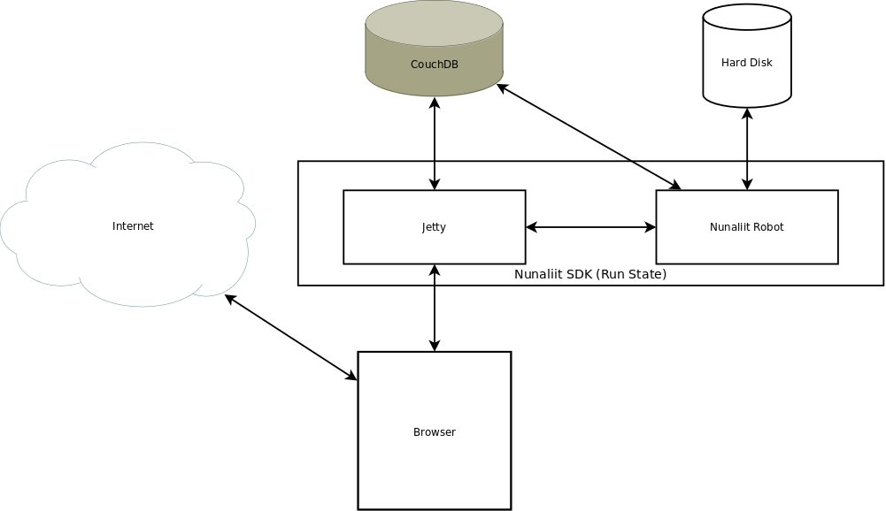

<h2>Table of Contents</h2>
<ol>
<li><a href="#contributing">Contributing</a>
<li><a href="#sdk">SDK Structure</a>
<ul>
<li><a href="#sdk_webapp">Web Application</a></li>
</ul>
</li>
<li><a href="#building">Building Nunaliit</a></li>
<li><a href="#project">Nunaliit Project</a></li>
<li><a href="#project_modules">Sub-Modules</a></li>
<li><a href="#webapp">Client Application</a>
<ul>
<li><a href="#webapp_debugging">Debugging Client Application</a></li>
<li><a href="#webapp_dispatcher">Dispatcher</a>
<ul>
<li><a href="#webapp_dispatcher_debuggin">Dispatcher Debugging</a></li>
</ul>
</li>
<li><a href="#webapp_dispatcher_event_types">Event Types</a>
<ul>
<li><a href="#webapp_dispatcher_event_types_addLayerToMap">addLayerToMap</a></li>
<li><a href="#webapp_dispatcher_event_types_authCurrentUserDoc">authCurrentUserDoc</a></li>
<li><a href="#webapp_dispatcher_event_types_authIsLoggedIn">authIsLoggedIn</a></li>
<li><a href="#webapp_dispatcher_event_types_authLoggedIn">authLoggedIn</a></li>
<li><a href="#webapp_dispatcher_event_types_authLoggedOut">authLoggedOut</a></li>
<li><a href="#webapp_dispatcher_event_types_cacheRetrieveDocument">cacheRetrieveDocument</a></li>
<li><a href="#webapp_dispatcher_event_types_canvasDisplay">canvasDisplay</a></li>
<li><a href="#webapp_dispatcher_event_types_canvasGetStylesInUse">canvasGetStylesInUse</a></li>
<li><a href="#webapp_dispatcher_event_types_canvasIsTypeAvailable">canvasIsTypeAvailable</a></li>
<li><a href="#webapp_dispatcher_event_types_canvasReportStylesInUse">canvasReportStylesInUse</a></li>
<li><a href="#webapp_dispatcher_event_types_clickedAgain">clickedAgain</a></li>
<li><a href="#webapp_dispatcher_event_types_configurationGetCurrentSettings">configurationGetCurrentSettings</a></li>
<li><a href="#webapp_dispatcher_event_types_displayIsTypeAvailable">displayIsTypeAvailable</a></li>
<li><a href="#webapp_dispatcher_event_types_displayRender">displayRender</a></li>
<li><a href="#webapp_dispatcher_event_types_documentContent">documentContent</a></li>
<li><a href="#webapp_dispatcher_event_types_documentContentCreated">documentContentCreated</a></li>
<li><a href="#webapp_dispatcher_event_types_documentContentUpdated">documentContentUpdated</a></li>
<li><a href="#webapp_dispatcher_event_types_documentCreated">documentCreated</a></li>
<li><a href="#webapp_dispatcher_event_types_documentDeleted">documentDeleted</a></li>
<li><a href="#webapp_dispatcher_event_types_documentListQuery">documentListQuery</a></li>
<li><a href="#webapp_dispatcher_event_types_documentListResults">documentListResults</a></li>
<li><a href="#webapp_dispatcher_event_types_documentSourceFromDocument">documentSourceFromDocument</a></li>
<li><a href="#webapp_dispatcher_event_types_documentUpdated">documentUpdated</a></li>
<li><a href="#webapp_dispatcher_event_types_documentVersion">documentVersion</a></li>
<li><a href="#webapp_dispatcher_event_types_editBeforeSave">editBeforeSave</a></li>
<li><a href="#webapp_dispatcher_event_types_editCancel">editCancel</a></li>
<li><a href="#webapp_dispatcher_event_types_editClosed">editClosed</a></li>
<li><a href="#webapp_dispatcher_event_types_editCreateFromGeometry">editCreateFromGeometry</a></li>
<li><a href="#webapp_dispatcher_event_types_editDocumentWKTReceived">editDocumentWKTReceived</a></li>
<li><a href="#webapp_dispatcher_event_types_editGeometryModified">editGeometryModified</a></li>
<li><a href="#webapp_dispatcher_event_types_editGetState">editGetState</a></li>
<li><a href="#webapp_dispatcher_event_types_editInitiate">editInitiate</a></li>
<li><a href="#webapp_dispatcher_event_types_editRefreshCompleted">editRefreshCompleted</a></li>
<li><a href="#webapp_dispatcher_event_types_editReportOriginalDocument">editReportOriginalDocument</a></li>
<li><a href="#webapp_dispatcher_event_types_editTriggerSave">editTriggerSave</a></li>
<li><a href="#webapp_dispatcher_event_types_find">find</a></li>
<li><a href="#webapp_dispatcher_event_types_findAvailabilityChanged">findAvailabilityChanged</a></li>
<li><a href="#webapp_dispatcher_event_types_findIsAvailable">findIsAvailable</a></li>
<li><a href="#webapp_dispatcher_event_types_focusOff">focusOff</a></li>
<li><a href="#webapp_dispatcher_event_types_focusOn">focusOn</a></li>
<li><a href="#webapp_dispatcher_event_types_focusOnSupplement">focusOnSupplement</a></li>
<li><a href="#webapp_dispatcher_event_types_hashChanged">hashChanged</a></li>
<li><a href="#webapp_dispatcher_event_types_historyBack">historyBack</a></li>
<li><a href="#webapp_dispatcher_event_types_historyForward">historyForward</a></li>
<li><a href="#webapp_dispatcher_event_types_historyGetState">historyGetState</a></li>
<li><a href="#webapp_dispatcher_event_types_historyHashModified">historyHashModified</a></li>
<li><a href="#webapp_dispatcher_event_types_historyReportState">historyReportState</a></li>
<li><a href="#webapp_dispatcher_event_types_languageSelect">languageSelect</a></li>
<li><a href="#webapp_dispatcher_event_types_loadedModuleContent">loadedModuleContent</a></li>
<li><a href="#webapp_dispatcher_event_types_login">login</a></li>
<li><a href="#webapp_dispatcher_event_types_loginShowForm">loginShowForm</a></li>
<li><a href="#webapp_dispatcher_event_types_logout">logout</a></li>
<li><a href="#webapp_dispatcher_event_types_mailShowMailForm">mailShowMailForm</a></li>
<li><a href="#webapp_dispatcher_event_types_mapBaseLayerChanged">mapBaseLayerChanged</a></li>
<li><a href="#webapp_dispatcher_event_types_mapGeometryAdded">mapGeometryAdded</a></li>
<li><a href="#webapp_dispatcher_event_types_mapGetLayers">mapGetLayers</a></li>
<li><a href="#webapp_dispatcher_event_types_mapInitialized">mapInitialized</a></li>
<li><a href="#webapp_dispatcher_event_types_mapRedrawLayer">mapRedrawLayer</a></li>
<li><a href="#webapp_dispatcher_event_types_mapResetExtent">mapResetExtent</a></li>
<li><a href="#webapp_dispatcher_event_types_mapSetExtent">mapSetExtent</a></li>
<li><a href="#webapp_dispatcher_event_types_mapSetInitialExtent">mapSetInitialExtent</a></li>
<li><a href="#webapp_dispatcher_event_types_mapSwitchToEditMode">mapSwitchToEditMode</a></li>
<li><a href="#webapp_dispatcher_event_types_modelCreate">modelCreate</a></li>
<li><a href="#webapp_dispatcher_event_types_modelGetInfo">modelGetInfo</a></li>
<li><a href="#webapp_dispatcher_event_types_modelGetList">modelGetList</a></li>
<li><a href="#webapp_dispatcher_event_types_modelGetState">modelGetState</a></li>
<li><a href="#webapp_dispatcher_event_types_modelStateUpdated">modelStateUpdated</a></li>
<li><a href="#webapp_dispatcher_event_types_moduleGetCurrent">moduleGetCurrent</a></li>
<li><a href="#webapp_dispatcher_event_types_modulePerformIntroduction">modulePerformIntroduction</a></li>
<li><a href="#webapp_dispatcher_event_types_navigationGetCurrent">navigationGetCurrent</a></li>
<li><a href="#webapp_dispatcher_event_types_navigationReportCurrent">navigationReportCurrent</a></li>
<li><a href="#webapp_dispatcher_event_types_playHoverSoundOff">playHoverSoundOff</a></li>
<li><a href="#webapp_dispatcher_event_types_playHoverSoundOn">playHoverSoundOn</a></li>
<li><a href="#webapp_dispatcher_event_types_playSoundOff">playSoundOff</a></li>
<li><a href="#webapp_dispatcher_event_types_playSoundOn">playSoundOn</a></li>
<li><a href="#webapp_dispatcher_event_types_preDocCreation">preDocCreation</a></li>
<li><a href="#webapp_dispatcher_event_types_replaceHash">replaceHash</a></li>
<li><a href="#webapp_dispatcher_event_types_reportModuleDisplay">reportModuleDisplay</a></li>
<li><a href="#webapp_dispatcher_event_types_reportModuleDocument">reportModuleDocument</a></li>
<li><a href="#webapp_dispatcher_event_types_requestDocument">requestDocument</a></li>
<li><a href="#webapp_dispatcher_event_types_requestDocuments">requestDocuments</a></li>
<li><a href="#webapp_dispatcher_event_types_requestLayerDefinition">requestLayerDefinition</a></li>
<li><a href="#webapp_dispatcher_event_types_requestLayerDefinitions">requestLayerDefinitions</a></li>
<li><a href="#webapp_dispatcher_event_types_requestUserDocument">requestUserDocument</a></li>
<li><a href="#webapp_dispatcher_event_types_requestUserDocumentComplete">requestUserDocumentComplete</a></li>
<li><a href="#webapp_dispatcher_event_types_ribbonGetInfoDisplay">ribbonGetInfoDisplay</a></li>
<li><a href="#webapp_dispatcher_event_types_searchActivated">searchActivated</a></li>
<li><a href="#webapp_dispatcher_event_types_searchDeactivated">searchDeactivated</a></li>
<li><a href="#webapp_dispatcher_event_types_searchInitiate">searchInitiate</a></li>
<li><a href="#webapp_dispatcher_event_types_searchResults">searchResults</a></li>
<li><a href="#webapp_dispatcher_event_types_selected">selected</a></li>
<li><a href="#webapp_dispatcher_event_types_selectedSupplement">selectedSupplement</a></li>
<li><a href="#webapp_dispatcher_event_types_setHash">setHash</a></li>
<li><a href="#webapp_dispatcher_event_types_setMapLayerVisibility">setMapLayerVisibility</a></li>
<li><a href="#webapp_dispatcher_event_types_showCustom">showCustom</a></li>
<li><a href="#webapp_dispatcher_event_types_showPreprocessElement">showPreprocessElement</a></li>
<li><a href="#webapp_dispatcher_event_types_simplifiedGeometryReport">simplifiedGeometryReport</a></li>
<li><a href="#webapp_dispatcher_event_types_simplifiedGeometryRequest">simplifiedGeometryRequest</a></li>
<li><a href="#webapp_dispatcher_event_types_splashShowSplashPage">splashShowSplashPage</a></li>
<li><a href="#webapp_dispatcher_event_types_splashWidgetSetPages">splashWidgetSetPages</a></li>
<li><a href="#webapp_dispatcher_event_types_start">start</a></li>
<li><a href="#webapp_dispatcher_event_types_unselected">unselected</a></li>
<li><a href="#webapp_dispatcher_event_types_userDocument">userDocument</a></li>
<li><a href="#webapp_dispatcher_event_types_userFocusOff">userFocusOff</a></li>
<li><a href="#webapp_dispatcher_event_types_userFocusOn">userFocusOn</a></li>
<li><a href="#webapp_dispatcher_event_types_userInfo">userInfo</a></li>
<li><a href="#webapp_dispatcher_event_types_userIntentChanged">userIntentChanged</a></li>
<li><a href="#webapp_dispatcher_event_types_userIntentGetCurrent">userIntentGetCurrent</a></li>
<li><a href="#webapp_dispatcher_event_types_userSelect">userSelect</a></li>
<li><a href="#webapp_dispatcher_event_types_userSelectCancelled">userSelectCancelled</a></li>
<li><a href="#webapp_dispatcher_event_types_userUnselect">userUnselect</a></li>
<li><a href="#webapp_dispatcher_event_types_utilityCreate">utilityCreate</a></li>
<li><a href="#webapp_dispatcher_event_types_waitReport">waitReport</a></li>
<li><a href="#webapp_dispatcher_event_types_widgetDisplay">widgetDisplay</a></li>
<li><a href="#webapp_dispatcher_event_types_widgetIsTypeAvailable">widgetIsTypeAvailable</a></li>
<li><a href="#webapp_dispatcher_event_types_windowResized">windowResized</a></li>
</ul>
</li>
<li><a href="#webapp_selectionRedirector">Selection Redirector</a></li>
<li><a href="#webapp_customCanvas">Custom Canvas</a>
<ul>
<li><a href="#webapp_customCanvas_module">Module Document</a></li>
<li><a href="#webapp_customCanvas_events">Canvas Events</a></li>
<li><a href="#webapp_customCanvas_nunaliitCustom">Nunaliit Custom</a></li>
</ul>
</li>
<li><a href="#webapp_customWidget">Custom Widget</a>
<ul>
<li><a href="#webapp_customWidget_module">Module Document</a></li>
<li><a href="#webapp_customWidget_events">Widget Events</a></li>
<li><a href="#webapp_customWidget_nunaliitCustom">Nunaliit Custom</a></li>
</ul>
</li>
<li><a href="#webapp_customDocumentList">Custom Document List</a>
<ul>
<li><a href="#webapp_customDocumentList_htmlClasses">HTML Classes</a></li>
<li><a href="#webapp_customDocumentList_nunaliitCustom">Nunaliit Custom</a></li>
</ul>
</li>
</ul>
</li>
<li><a href="#document">Document Structure</a>
<ul>
<li><a href="#document_geometry">Geometry</a></li>
</ul>
</li>
<li><a href="#server">Nunaliit Server</a>
<ul>
<li><a href="#server_simplifyGeometry">Simplified Geometries</a>
<ul>
<li><a href="#server_simplifyGeometry_servlet">Simplified Geometry Servlet</a></li>
<li><a href="#server_simplifyGeometry_robot">Simplified Geometry Robot</a></li>
<li><a href="#server_simplifyGeometry_lifecycle">Life Cycle of a Geometry</a></li>
</ul>
</li>
<li><a href="#server_date">Dates</a>
<ul>
<li><a href="#server_date_structure">Date Structure</a></li>
<li><a href="#server_date_lifecycle">Life Cycle of a Date Structure</a></li>
<li><a href="#server_date_indexing">Date Indexing</a></li>
</ul>
</li>
<li><a href="#server_upload">Uploaded Files</a>
<ul>
<li><a href="#server_upload_documentStructure">Document Structure</a></li>
<li><a href="#server_upload_uploadProcess">Upload Process</a></li>
</ul>
</li>
</ul>
</li>
</ol>

<h2><a name="contributing">Contributing</a></h2>

Nunaliit is a project run by the Geomatics and Cartographic Research Centre at Carleton University in Ottawa, Ontario, Canada. Code, documentation, and process contributions are very welcome. Please use Github to generate a pull request with changes or contact the development team using our <a href="https://rocketchat.gcrc.carleton.ca/channel/nunaliit">developer Rocket.Chat channel</a>. When making a contribution, you will be expected to openly license your code using the BSD (revised) open source license and also license the project administrators to re-license Nunaliit (including your contributions) in the future using an OSI-approved open source license as they deem fit.

<!-- ****************************************************************************** -->
<h2><a name="sdk">SDK Structure</a></h2>

The Nunaliit SDK is a command-line program written in Java. This program
creates and manages a set of files in a directory, known as the <b>atlas directory</b>. The 
configuration found in the atlas directory is used to connect to a CouchDB database, where
the atlas data is stored.

Nunaliit, the project that hosts the Nunaliit SDK, uses Maven 2 to build the components of
the platform, which includes the SDK.

<h3><a name="sdk_webapp">Web Application</a></h3>

The product of the Nunaliit framework is a web application accessible to anyone armed with a
web browser. Via this web application, a user can view or update information found in the atlas.

The web application is served, over HTTP, by the Nunaliit SDK when the command "run" is specified.
While running, the Nunaliit framework employs Jetty to serve the content of the atlas to the client's browser.

The web application is composed of:
<ul>
	<li>HTML Pages</li>
	<li>CSS Files</li>
	<li>Javascript</li>
	<li>Background imagery</li>
	<li>JSON data</li>
	<li>Web services</li>
</ul>

All HTML pages, CSS files and Javascript files are stored in the CouchDb database. They are
served to the browser via the Nunaliit SDK. In particular, the Jetty servlet container is
configured to proxy those files given some URL patterns.

The maps served in Nunaliit require background imagery. This imagery is usually served
directly from the Internet (without interventions from Nunaliit) using services such
as Google Maps, Bing or OpenStreet.

The information displayed by the Nunaliit framework and used to control user interaction
is served as JSON data obtained by the browser using AJAX. The data is stored in the CouchDb
database and is proxied by the Jetty servlet container embedded within the Nunaliit
SDK.

To supplement the data found in the database, a number of web services are required. These
web services are implemented using servlets supplied by Nunaliit and include services such
as upload service, multi-media conversion service, export services, and others.

The web services in Nunaliit are often referred to as the "Nunaliit Robot", since these
services implement threads that are periodically active, independent of incoming requests. These
threads monitor the database and perform work such as uploading approved media files.

<!-- ****************************************************************************** -->
<h2><a name="building">Building Nunaliit</a></h2>

Nunaliit can be built from the Nunaliit source repository. The tools required
to build Nunaliit are:
<ul>
	<li>Git</li>
	<li>Java JDK 8</li>
	<li>maven2</li>
	<li>ant</li>
</ul>

Here are the steps required to build Nunaliit from source.

<h3>1. Check out the Nunaliit project</h3>
<pre>
git clone https://github.com/GCRC/nunaliit.git
</pre>

<h3>2. Build Nunaliit</h3>
<pre>
cd nunaliit
mvn clean install
</pre>

Note: If you encounter build errors, check that maven is using jdk 8 for building (`mvn -version`) and if you are using a headless jdk, you may need to disable GNOME accessibility options  by editing `/etc/java-8-openjdk/accessibility.properties` and commenting out the line `assistive_technologies=org.GNOME.Accessibility.AtkWrapper`. Newer JDK versions than 8 are not currently supported.

<h3>3. Locate packaged files</h3>

Nunaliit is packaged in two versions during the build 
process: one TAR file (gzipped) and one ZIP file. For Linux/MacOS installation,
the TAR file is preferred.

Both files are located in the directory:

<pre>nunaliit2-couch-sdk/target</pre>

<!-- ****************************************************************************** -->
<h2><a name="project">Nunaliit Project</a></h2>

	The Nunaliit Project is a Java project managed by Maven composed of multiple sub-modules. The
	sub-module that generates the Nunaliit SDK is nunaliit2-couch-sdk. The relations of this sub-module
	to other sub-modules in the Nunaliit project can be inferred by following the dependencies declared
	in Maven. Please, refer to the sub-module pom.xml file.  

<h2><a name="project_modules">Sub-Modules</a></h2>

	A quick description of all sub-modules:
	<ul>
		<li><b>nunaliit2-adhocQueries</b>: 
			<i>Not used in Nunaliit Couch SDK.</i>
			This is a servlet that implements custom queries to a SQL database. Queries
			can be defined in configuration files and requested from the wen application. 
		</li>
		<li><b>nunaliit2-auth-common</b>:
			<i>Not used in Nunaliit Couch SDK.</i>
			Jar library that provides classes and functions common to all authentication
			servlets.
		</li>
		<li><b>nunaliit2-auth-cookie</b>:
			<i>Not used in Nunaliit Couch SDK.</i>
			This sub-module provides a web filter used to manage user authentication
			by using HTTP cookies to track users.
		</li>
		<li><b>nunaliit2-auth-http</b>:
			<i>Not used in Nunaliit Couch SDK.</i>
			This sub-module provides a web filter used to manage user authentication
			by using HTTP authentication to track users.
		</li>
		<li><b>nunaliit2-couch-application</b>:
			Web application project that contains resources for building the
			_design/atlas CouchDb Design Document. This sub-module contains all the code associated
			with views and document validation. It also includes the code for all tool pages.
		</li>
		<li><b>nunaliit2-couch-client</b>:
			Java library that implements a generic client to CouchDb. It also provides classes
			to dump and restore documents to a CouchDb database.
		</li>
		<li><b>nunaliit2-couch-command</b>:
			Implements the "nunaliit" command-line utility used in the Nunaliit SDK. This is the
			main entry point for the Nunaliit SDK. 
		</li>
		<li><b>nunaliit2-couch-date</b>:
			Provides a servlet used to index all dates handled by Nunaliit and perform date-related
			research. 
		</li>
		<li><b>nunaliit2-couch-export</b>:
			Servlet that provides exporting of data from a CouchDb database.
		</li>
		<li><b>nunaliit2-couch-mobile</b>:
			<i>Not used in Nunaliit Couch SDK.</i>
			Includes code for iPad application. Also, includes code required to build a design
			document used by mobile applications.
		</li>
		<li><b>nunaliit2-couch-onUpload</b>:
			Implements plug-in for Upload Servlet. This is the code that is called every time a file
			is uploaded. This sub-module also includes the code related to the on-going thread that
			implements "robot" behaviour, where the database is constantly monitored and work is
			performed for file approval. Finally, this sub-module also contains the code that initiates
			multimedia, GPX and PDF conversions. 
		</li>
		<li><b>nunaliit2-couch-replication</b>:
			This sub-module implements an on-going task that can trigger replication based on
			information found in configuration.
		</li>
		<li><b>nunaliit2-couch-sdk</b>:
			This sub-module assembles the "nunaliit" command-line utility with resource files required
			at run-time. This is the sub-module that generates the "Nunaliit Couch SDK".
		</li>
		<li><b>nunaliit2-couch-simplifiedGeometry</b>:
			This is a servlet that detects new geometries and create simplifications for them. This
			servlet also answers requests for specific geometries.
		</li>
		<li><b>nunaliit2-couch-submission</b>:
			This servlet implements a robot thread to deal with the submission database. When a submission
			database is in use, any change to documents are first submitted to the submission database fro approval.
			The submission robot may approve some changes automatically based on the submitter's roles. 
		</li>
		<li><b>nunaliit2-couch-user</b>:
			Implements a servlet used to access user information from _users database, in CouchDb.
			This sub-module also contains the code required to build the design document _design/nunaliit
			which is installed in the _users database.
		</li>
		<li><b>nunaliit2-couch-utils</b>:
			Java library used to perform Nunaliit-specific action on CouchDb database JSON documents.
		</li>
		<li><b>nunaliit2-css</b>:
			Java library used to handle CSS files. Generates a command-line utility used by other
			sub-modules to merge CSS files.
		</li>
		<li><b>nunaliit2-dbSec</b>:
			<i>Not used in Nunaliit Couch SDK.</i>
			Java library that implements authorization services for accessing data from a database
			accessed over JDBC. The configuration for authorization is stored in the database.
		</li>
		<li><b>nunaliit2-dbWeb</b>:
			<i>Not used in Nunaliit Couch SDK.</i>
			Servlet that implements a web interface to the dbSec services.
		</li>
		<li><b>nunaliit2-geom</b>:
			Java library that provides basic interface and functions to handle geometries. Includes
			support for handling GeoJSON and Well-Known Text (WKT).
		</li>
		<li><b>nunaliit2-gpx</b>:
			Java library used to read GPX files.
		</li>
		<li><b>nunaliit2-gpx-jaxb</b>:
			JAXB project used to generate all the classes for handling GPX, based on the GPX schema
			documents. 
		</li>
		<li><b>nunaliit2-javascript</b>:
			Java library used to handle Javascript files. Generates a command-line utility used by other
			sub-modules to merge and minimize Javascript files.
		</li>
		<li><b>nunaliit2-jdbc</b>:
			<i>Not used in Nunaliit Couch SDK.</i>
			Code used to connect to a JDBC database based on information found in configuration files.
		</li>
		<li><b>nunaliit2-jdbc-json</b>:
			<i>Not used in Nunaliit Couch SDK.</i>
			Servlet used to query JDBC database using JSON interface.
		</li>
		<li><b>nunaliit2-js</b>:
			This sub-module includes all the Javascript files necessary for creating
			the Nunaliit Javascript libraries. It also includes the supporting CSS files. 
		</li>
		<li><b>nunaliit2-js-external</b>:
			This sub-module includes third party Javascript libraries required for
			the proper functioning of Nunaliit.
		</li>
		<li><b>nunaliit2-json</b>:
			Java library that provides supporting functions in handling JSON.
		</li>
		<li><b>nunaliit2-mail</b>:
			This sub-module provides libraries to send SMTP messages. It also provides a servlet that
			accept web mail forms from end users.
		</li>
		<li><b>nunaliit2-multimedia</b>:
			Java library that provides interface to command-line utilities that handle
			multimedia files, such as avconv (formerly ffmpeg), ImageMagick and file (linux).
		</li>
		<li><b>nunaliit2-progress</b>:
			Servlet that provides progress information to the web client. Mostly used during
			file upload.
		</li>
		<li><b>nunaliit2-search</b>:
			<i>Not used in Nunaliit Couch SDK.</i>
			Servlet used to accept text search requests for atlas based on JDBC database.
		</li>
		<li><b>nunaliit2-security</b>:
			This sub-module provides librabries that implements encoding and protocols used to
			perform security-specific tasks.
		</li>
		<li><b>nunaliit2-upload</b>:
			Servlet that provide the capability of uploading files. It accepts an upload listening
			plug-in which is triggered when a new file is uploaded.
		</li>
		<li><b>nunaliit2-utils</b>:
			Java library that provides general common functions.
		</li>
	</ul>

<!-- ****************************************************************************** -->
<h2><a name="webapp">Client Application</a></h2>

	The client application is the portion of the web application that runs in the
	user's browser. This application is composed of HTML, Javascript and CSS. The
	technologies employed in the client application include:
	<ul>
		<li>Nunaliit Javascript Library</li>
		<li>jQuery and jQuery-UI</li>
		<li>OpenLayers</li>
		<li>Handlebars</li>
	</ul>

<!-- ------------------------------------------------------------------------------ -->
<h3><a name="webapp_debugging">Debugging Client Application</a></h3>

	Usually, the client application loads up minimized versions of the Javascript libraries
	to alleviate network resources and speed up loading. Debug versions of the libraries are
	provided to help debugging at run-time. 	

	To load up the debug versions of the Nunaliit Javascript libraries, replace the javascript elements
	loading Nunaliit with the following ones:
	<pre>
		&lt;script type="text/javascript" src="nunaliit2/nunaliit2-debug.js"&gt;&lt;/script&gt;
		&lt;script type="text/javascript" src="nunaliit2/nunaliit2-couch-debug.js"&gt;&lt;/script&gt;
	</pre>

	To load up the debug versions of the jQuery Javascript libraries, replace the javascript elements
	loading jQuery with the following ones:
	<pre>
		&lt;script type="text/javascript" src="js-external/js/jquery.js"&gt;&lt;/script&gt;
		&lt;script type="text/javascript" src="js-external/js/jquery-ui.js"&gt;&lt;/script&gt;
	</pre>

<!-- ------------------------------------------------------------------------------ -->
<h3><a name="webapp_dispatcher">Dispatcher</a></h3>

The dispatcher is responsible for distributing events to the components that are observing
those events. The dispatcher offers the following features:
<ul>
	<li>Events are dispatched in the same order as they were submitted</li>
	<li>Synchronous calls are available</li>
	<li>Easy debugging is available, with possible logging</li>
</ul>

<h4><a name="webapp_dispatcher_debuggin">Dispatcher Debugging</a></h4>

	The configuration is usually displayed at the console. The dispatcher is reported as the
	"dispatchService" in the directory of the configuration. The dispatcher has an attribute
	named "options". This options object contains two boolean variables: logging and
	loggingIncludesMessage.

	Setting the variable "logging" to true instructs the dispatcher to log to the console each
	event that is dispatched. If, furthermore, the variable "loggingIncludesMessage" is set, then
	the message content is included to the console.

	The dispatcher contains also a variable named "listeners". This is a hash map of event types
	associated with an array of observers for this event type.

<!-- ------------------------------------------------------------------------------ -->
<h3><a name="webapp_dispatcher_event_types">Event Types</a></h3>

<h4><a name="webapp_dispatcher_event_types_addLayerToMap">addLayerToMap</a></h4>

	This event is used to instruct maps to add a layer definition. 

<h4><a name="webapp_dispatcher_event_types_authCurrentUserDoc">authCurrentUserDoc</a></h4>

	This event reports the user document (complete user document) of the user currently
	logged in. This event is generally sent after the event "authLoggedIn". If a user
	document is not available, or not accessible, then this event is not generated.
	This event has the following attributes:
	<ul>
		<li>userDoc: Document associated with the currently logeed in user.</li>
	</ul>

<h4><a name="webapp_dispatcher_event_types_authIsLoggedIn">authIsLoggedIn</a></h4>

	This is a synchronous call to query if a user is currently logged in.
	This event has the following attributes:
	<ul>
		<li>isLoggedIn: Boolean which is set to true if a user is currently logged in.</li>
	</ul>

<h4><a name="webapp_dispatcher_event_types_authLoggedIn">authLoggedIn</a></h4>

	This event reports that a user logged in.
	This event has the following attributes:
	<ul>
		<li>user: Object that represents the user that logged in</li>
	</ul>

<h4><a name="webapp_dispatcher_event_types_authLoggedOut">authLoggedOut</a></h4>

	This event reports that a user logged out.

<h4><a name="webapp_dispatcher_event_types_cacheRetrieveDocument">cacheRetrieveDocument</a></h4>

	This is a synchronous call to query all caches for a particular document, based on 
	a document identifier.
	This event has the following attributes:
	<ul>
		<li>docId: (Input) String. Identifier of the document that is seeked.
		</li>
		<li>doc: (Output) The document found in cache. Null, if not found.
		</li>
	</ul>

<h4><a name="webapp_dispatcher_event_types_canvasDisplay">canvasDisplay</a></h4>

	This event instructs a canvas handler to display itself to a portion of the
	screen.
	This event has the following attributes:
	<ul>
		<li>canvasType: String. Type of canvas to be displayed
		</li>
		<li>canvasOptions: Object. Options associated with the canvas being displayed.
		</li>
		<li>canvasId: String. Element identifier where the canvas should be displayed. This
		element is generally a &lt;div&gt; element.
		</li>
		<li>interactionId: String. Element identifier where the menu should be displayed. This
		element is generally a &lt;div&gt; element.
		</li>
		<li>config: Object. This is the configuration object generated by Nunaliit.
		</li>
		<li>moduleDisplay: Object. This is the instance of ModuleDisplay that has requested the event.
		</li>
		<li>onSuccess: Function. This function must be called when the displaying of the canvas
		is completed. This function must be called only once. This function must not be called
		if an error was reported (onError).
		</li>
		<li>onError: Function. This function must be called if an error was encountered during the
		displaying of the canavs. This function must be called at most once. This function accepts
		one parameter, which is a string to describe the error.
		</li>
	</ul>

<h4><a name="webapp_dispatcher_event_types_canvasGetStylesInUse">canvasGetStylesInUse</a></h4>

	This is a synchronous call to query a particualr canvas and retrieve the styles currently
	in use. 
	This event has the following attributes:
	<ul>
		<li>canvasName: (Input) String. The name of the canvas being queried.
		</li>
		<li>stylesInUse: (Output) An object representing the style inventory currently used
		by the canvas.
		</li>
	</ul>

<h4><a name="webapp_dispatcher_event_types_canvasIsTypeAvailable">canvasIsTypeAvailable</a></h4>

	This is a synchronous call to query all canvas handlers and find out if a particular canvas
	configuration can be displayed.
	This event has the following attributes:
	<ul>
		<li>canvasType: (Input) String. Type of canvas to be displayed
		</li>
		<li>canvasOptions: (Input) Object. Options associated with the canvas being displayed.
		</li>
		<li>isAvailable: (Output) Is initially false. Should be set to true by a handler able
		to satisfy the type and options presented.
		</li>
	</ul>

<h4><a name="webapp_dispatcher_event_types_canvasReportStylesInUse">canvasReportStylesInUse</a></h4>

	This event is used to announced that a new set of styles is in use by a canvas.
	This event has the following attributes:
	<ul>
		<li>canvasName: String. The name of the canvas reporting new styles.
		</li>
		<li>stylesInUse: An object representing the style inventory currently used
		by the canvas.
		</li>
	</ul>

<h4><a name="webapp_dispatcher_event_types_clickedAgain">clickedAgain</a></h4>

	This event is used to announce that a currently selected feature was clicked again.
	This event has the following attributes:
	<ul>
		<li>docId: The document identifier of the feature that was clicked again.
		</li>
	</ul>

<h4><a name="webapp_dispatcher_event_types_configurationGetCurrentSettings">configurationGetCurrentSettings</a></h4>

	This is a synchronous call to retrieve from the configuration service the current
	configuration settings.
	This event has the following attributes:
	<ul>
		<li>configuration: (Output) Configuration object.
		</li>
	</ul>

<h4><a name="webapp_dispatcher_event_types_displayIsTypeAvailable">displayIsTypeAvailable</a></h4>

	This is a synchronous call to query all display handlers and find out if a particular display
	configuration can be displayed. A display handler draws the information about documents
	in the side panel.
	This event has the following attributes:
	<ul>
		<li>displayType: (Input) String. Type of display to be rendered
		</li>
		<li>displayOptions: (Input) Object. Options associated with the display being rendered.
		</li>
		<li>isAvailable: (Output) Is initially false. Should be set to true by a handler able
		to satisfy the type and options presented.
		</li>
	</ul>

<h4><a name="webapp_dispatcher_event_types_displayRender">displayRender</a></h4>

	This event instructs a display handler to render itself to a portion of the
	screen.
	This event has the following attributes:
	<ul>
		<li>displayType: String. Type of display to be rendered
		</li>
		<li>displayOptions: Object. Options associated with the display being rendered.
		</li>
		<li>displayId: String. Element identifier where the display should be rendered. This
		element is generally a &lt;div&gt; element.
		</li>
		<li>interactionId: String. Element identifier where the menu should be displayed. This
		element is generally a &lt;div&gt; element.
		</li>
		<li>config: Object. This is the configuration object generated by Nunaliit.
		</li>
		<li>moduleDisplay: Object. This is the instance of ModuleDisplay that has requested the event.
		</li>
		<li>onSuccess: Function. This function must be called when the rendering of the display
		is completed. This function must be called only once. This function must not be called
		if an error was reported (onError).
		</li>
		<li>onError: Function. This function must be called if an error was encountered during the
		rendering of the display. This function must be called at most once. This function accepts
		one parameter, which is a string to describe the error.
		</li>
	</ul>

<h4><a name="webapp_dispatcher_event_types_documentContent">documentContent</a></h4>

	This event is sent when a the content of a document is received. This event is sent whenever
	the events "documentContentCreated" and "documentContentUpdated" are sent. This event can also
	be sent as the result of a "requestDocument" event.
	This event has the following attributes:
	<ul>
		<li>docId: String. Identifier of the document.
		</li>
		<li>doc: Object. Content of document.
		</li>
	</ul>

<h4><a name="webapp_dispatcher_event_types_documentContentCreated">documentContentCreated</a></h4>

	This event is sent when a new document is created. This event differs
	from the "documentCreated" event in that it includes the document
	itself.
	This event has the following attributes:
	<ul>
		<li>docId: String. Identifier of the document that was created.
		</li>
		<li>doc: Object. Content of document that was created.
		</li>
	</ul>

<h4><a name="webapp_dispatcher_event_types_documentContentUpdated">documentContentUpdated</a></h4>

	This event is sent when an existing document is updated. This event differs
	from the "documentUpdated" event in that it includes the document
	itself.
	This event has the following attributes:
	<ul>
		<li>docId: String. Identifier of the document that was updated.
		</li>
		<li>doc: Object. Content of document that was updated.
		</li>
	</ul>

<h4><a name="webapp_dispatcher_event_types_documentCreated">documentCreated</a></h4>

	This event is sent when a new document is created. This is triggered by
	server-side code. This event includes only the document identifier.
	This event has the following attributes:
	<ul>
		<li>docId: String. Identifier of the document that was created.
		</li>
	</ul>

<h4><a name="webapp_dispatcher_event_types_documentDeleted">documentDeleted</a></h4>

	This event is sent when an existing document is deleted. This is triggered by
	server-side code. This event includes only the document identifier.
	This event has the following attributes:
	<ul>
		<li>docId: String. Identifier of the document that was deleted.
		</li>
	</ul>

<h4><a name="webapp_dispatcher_event_types_documentListQuery">documentListQuery</a></h4>

	This event is sent when a list of documents is required. This event includes
	the list type and the list name. When the list of documents is available, it is
	sent via the event "documentListResults".
	This event has the following attributes:
	<ul>
		<li>listType: String. Method used to retrieve a list. The Nunaliit framework
		defines: 'layer' and 'schema'.
		</li>
		<li>listName: String. Name of the list. This is dependent on the list type. For
		the type 'layer', this is the identifier for the layer to be retrieve. As well,
		for type 'layer', this can be a comma seperated list of layer identifiers.
		</li>
	</ul>

<h4><a name="webapp_dispatcher_event_types_documentListResults">documentListResults</a></h4>

	This event is sent when a list of documents has been requested and retrieved. This is
	an answer to the event "documentListQuery". This event includes the list type and the 
	list name that were requested in the query. It also includes a list of document ids that
	are the results of the query. Also, it is possible that the component where this message
	originates also have the documents. If this is the case, the event also includes the
	documents themselves.
	This event has the following attributes:
	<ul>
		<li>listType: String. Method used to retrieve a list. The Nunaliit framework
		defines: 'layer' and 'schema'.
		</li>
		<li>listName: String. Name of the list. This is dependent on the list type. For
		the type 'layer', this is the identifier for the layer to be retrieve. As well,
		for type 'layer', this can be a comma seperated list of layer identifiers.
		</li>
		<li>docIds: Array of Strings. Identifiers of the documents that match the original
		query.
		</li>
		<li>docs: (Optional) Array of Objects. Documents that match the original query.
		</li>
	</ul>

<h4><a name="webapp_dispatcher_event_types_documentSourceFromDocument">documentSourceFromDocument</a></h4>

	This is a synchronous call to obtain a document source, from a given document.
	If a document source recognizes the document in the event as one of its own,
	then it sets itself as the event attribute 'documentSource'.
	This event has the following attributes:
	<ul>
		<li>doc: (Input) Document for which a document source is seeked.</li>
		<li>documentSource: (Output) An instance of document source.</li>
	</ul>

<h4><a name="webapp_dispatcher_event_types_documentUpdated">documentUpdated</a></h4>

	This event is sent when an existing document is updated. This is triggered by
	server-side code. This event includes only the document identifier.
	This event has the following attributes:
	<ul>
		<li>docId: String. Identifier of the document that was updated.
		</li>
	</ul>

<h4><a name="webapp_dispatcher_event_types_documentVersion">documentVersion</a></h4>

	This event is sent when a new document revision is detected. This event should
	only be sent to report the latest revision of a document. This event includes only
	the document identifier and the detected revision.
	This event has the following attributes:
	<ul>
		<li>docId: String. Identifier of the document.
		</li>
		<li>rev: String. Version of the document.
		</li>
	</ul>

<h4><a name="webapp_dispatcher_event_types_editBeforeSave">editBeforeSave</a></h4>

	This is a synchronous event used to access the document once the Save button has been clicked when creating or editing documents.
	This event contains the following attributes:
	<ul>
		<li>doc: Document being saved</li>
		<li>shouldContinue: Defaults to true, determines if the document should continue to be saved</li>
	</ul>

<h4><a name="webapp_dispatcher_event_types_editCancel">editCancel</a></h4>

	This event is used to cancel the current document editor.

<h4><a name="webapp_dispatcher_event_types_editClosed">editClosed</a></h4>

	This event is sent by the document editor when an editor session is terminated.
	This event contains the following attributes:
	<ul>
		<li>docId: Document identifier of document that was edited</li>
		<li>saved: Set to true if document was saved</li>
		<li>inserted: Set to true if document was created</li>
		<li>updated: Set to true if document was updated</li>
		<li>deleted: Set to true if document was deleted</li>
		<li>cancelled: Set to true if the editor session was cancelled</li>
	</ul>

<h4><a name="webapp_dispatcher_event_types_editCreateFromGeometry">editCreateFromGeometry</a></h4>

	This event can be sent by any process wishing to create a new document based on a geometry.
	It is generally sent by a map canvas. This events is equivalent to "editInitiate".
	This event contains the following attributes:
	<ul>
		<li>geometry: An instance of OpenLayers.Geometry. This is the geometry that
		should be used to initialize the new document.</li>
		<li>projection: An instance of OpenLayers.Projection. This represents the projection
		that expresses the geometry given in the event.</li>
	</ul>

<h4><a name="webapp_dispatcher_event_types_editDocumentWKTReceived">editDocumentWKTReceived</a></h4>

	This synchronous event is dispatched when a document is being edited and it has a WKT (attachment) available and has been received. This event has the following attributes:
	<ul>
		<li>doc: The current instance of the document with the newly received WKT added to it.</li>
	</ul> 

<h4><a name="webapp_dispatcher_event_types_editGeometryModified">editGeometryModified</a></h4>

	This event is used only during a document editing session. It indicates that the geometry
	associated with the edited document has been modified. This event has the following attributes:
	<ul>
		<li>docId: Document identifier of the document being edited.</li>
		<li>geom: Instance of OpenLayers Geometry. Represents the current state of the geometry.</li>
		<li>proj: Instance of OpenLayers Projection. Projection associated with the geometry.</li>
	</ul> 

<h4><a name="webapp_dispatcher_event_types_editGetState">editGetState</a></h4>

	This is a synchronous event used to find out the state of the editor. 
	This event has the following attributes:
	<ul>
		<li>isEditing: (Output) Boolean. Set if an editor is currently editing a document.</li>
	</ul> 

<h4><a name="webapp_dispatcher_event_types_editInitiate">editInitiate</a></h4>

	This event is used to initiate a document editing session. This event should
	have the following attribute:
	<ul>
		<li>doc: Contains the document for editing</li>
	</ul>

<h4><a name="webapp_dispatcher_event_types_editRefreshCompleted">editRefreshCompleted</a></h4>

	This is a synchronous event indicating that the current editing schema form has completed its refresh.
	This event contains the following attributes:
	<ul>
		<li>element: The form element that was refreshed</li>
		<li>doc: Document associated with the current edit</li>
	</ul>

<h4><a name="webapp_dispatcher_event_types_editReportOriginalDocument">editReportOriginalDocument</a></h4>

	This event is sent by the editor when the effective document is computed for edit.
	When starting an edit session, an updated version of the document is retrieved from the database. In
	some cases, the original document needs to be rebuilt. For example, if the document contains a geometry,
	then the version of the document saved in the database contains a simplified geometry. When the
	editor starts, the original geometry is also fetched and reinserted in the document so that the editor
	displays the original information. The event 'editReportOriginalDocument' reports the rebuilt document.
	This event has the following attribute:
	<ul>
		<li>docId: A compulsory String which is the document identifier for the edited document.</li>
		<li>doc: An compulsory Object which is the content of the document being edited. This content
		is the effective content and might differ to what was provided in 'editInitiate' as well as what
		is found in the database.</li>
		<li>geometry: Optional. An instance of OpenLayers.Geometry which represents the geometry found
		in the document, if any.</li>
		<li>projection: Optional. Must be provided if 'geometry' is specified. An instance of
		OpenLayers.Projection which represents the projection in which the geometry is expressed in.</li>
	</ul>

<h4><a name="webapp_dispatcher_event_types_editTriggerSave">editTriggerSave</a></h4>

	This event is used to force the current document editor to perform a save action. It is equivalent
	to pressing the "save" button in the form. This event does not contain any attributes.

<h4><a name="webapp_dispatcher_event_types_find">find</a></h4>

	This event should be sent when a particular document is seeked by the user.
	As a result of this event, if a map or canvas is displayed, it should center 
	make the features associated with the document more prominent to the user.
	This event has the following attributes:
	<ul>
		<li>docId: Required String. Document identifier of the document to be highlighted</li>
		<li>doc: Required Object. Document content</li>
	</ul>

<h4><a name="webapp_dispatcher_event_types_findAvailabilityChanged">findAvailabilityChanged</a></h4>

	This event is sent by a canvas when the set of documents that can be found on the
	canvas change. As a result, the widgets that display a button "Find on Map"
	should recompute the visibility of the button so that its state is consistent with
	the canvas.
	This event does not have any attribute.

<h4><a name="webapp_dispatcher_event_types_findIsAvailable">findIsAvailable</a></h4>

	This is a synchronous call to figure out if it makes sense to offer the user the option
	to find a document. If a listener to this event computes that it is possible to find this
	document, it sets the "isAvailable" flag to true.
	This event has the following attributes:
	<ul>
		<li>doc: (Input) Document content</li>
		<li>isAvailable: (Output) A boolean that should be initially false</li>
	</ul>

<h4><a name="webapp_dispatcher_event_types_focusOff">focusOff</a></h4>

	This event instructs the various observers that a document is out of focus.
	'Focus' refers to a passing interest, such as hovering the mouse over a feature
	represented by the document. When the focusOff event is received, previous actions taken
	for underlying the 'focusOn' state should be cancelled.

<h4><a name="webapp_dispatcher_event_types_focusOn">focusOn</a></h4>

	This event instructs the various observers that one or multiple documents are in focus.
	'Focus' refers to a passing interest, such as hovering the mouse over a feature
	associated with a document. By default, a focusOn event is generated by the 'eventSupport' service
	as a result of observing a 'userFocusOn' event . This behaviour can be modified if
	the user's focus should be translated before the Nunaliit's widgets react. This event
	contains the following attributes:
	<ul>
		<li>docId: String. Required attribute that specifies the identifier of the 
		           document in focus. This attribute is not required if 'docIds' is specified.</li>
		<li>docIds: Array of strings. Required attributes that specifies the identifiers
		            of the documents in focus. This attribute is mutually exclusive with 'docId'.</li>
		<li>doc: Optional object. Actual document that is in focus. This attribute should be used
		         only if thet 'docId' attribute is used. If the sender of this event already has
		         the content of the document, it saves the receiver from looking it up, if needed.</li>
		<li>docs: Optional array of objects. This is equivalent to the 'doc' attribute, but for
		          situations where multiple documents are in focus. This attribute should be used
		          if, and only if, all the documents associated with the list of identifiers can
		          be provided.</li>
		<li>feature: Optional. Map feature associated with focus.</li>
	</ul>

<h4><a name="webapp_dispatcher_event_types_focusOnSupplement">focusOnSupplement</a></h4>

	This event instructs the various observers that a new document must be added in focus.
	This is usually as a result of another document being currently in focus from a 'focusOn'
	event. This event has the following attributes:
	<ul>
		<li>docId: Document identifier of the document that should be added in focus.</li>
		<li>origin: Document identifier of the document that causes this supplement. If specified
		            and different than the document currently in focus, the observer should
		            disregard this event.</li>
		<li>intent: Optional. Name of intent. This is the intent associated with the supplement.
		            In the case of a map, the intent can describe a style to be used for the
		            feature during the 'focusOnSupplement'.</li>
	</ul>

<h4><a name="webapp_dispatcher_event_types_hashChanged">hashChanged</a></h4>

	This event reports that the hash portion of the window location URL was modified.
	This event has the following attributes:
	<ul>
		<li>hash: A String that is the new hash portion of the URL</li>
	</ul>

<h4><a name="webapp_dispatcher_event_types_historyBack">historyBack</a></h4>

	This event instructs the Nunaliit client application to move the current window location
	to the one prior found in the browser's history.

<h4><a name="webapp_dispatcher_event_types_historyForward">historyForward</a></h4>

	This event instructs the Nunaliit client application to move the current window location
	to the one found next in the browser's history.

<h4><a name="webapp_dispatcher_event_types_historyGetState">historyGetState</a></h4>

	This is a synchronous call to obtain the current location history.
	This event has the following attributes:
	<ul>
		<li>state: (Output) An object describing the current state of the history.</li>
	</ul>

<h4><a name="webapp_dispatcher_event_types_historyHashModified">historyHashModified</a></h4>

	This event informs all listeners that the location of the page is changed. It reports the
	new hash found in the href.
	This event has the following attributes:
	<ul>
		<li>hash: A String that is the new hash portion of the URL</li>
	</ul>

<h4><a name="webapp_dispatcher_event_types_historyReportState">historyReportState</a></h4>

	This event is sent every time the history state is changed. It reports the new state
	of the location history.
	This event has the following attributes:
	<ul>
		<li>state: An object describing the current state of the history.</li>
	</ul>

<h4><a name="webapp_dispatcher_event_types_languageSelect">languageSelect</a></h4>

	This event instructs the Nunaliit client application change the language in use in the
	page. In practice, this changes the cookie selecting the language and then reloads the
	page.
	This event has the following attributes:
	<ul>
		<li>lang: A String that represents the requested language</li>
	</ul>

<h4><a name="webapp_dispatcher_event_types_loadedModuleContent">loadedModuleContent</a></h4>

	This event informs clients that the module content is now displayed. This event is generated
	by the module service.

<h4><a name="webapp_dispatcher_event_types_login">login</a></h4>

	This event instructs the authentication service to attempt logging
	in as a user.
	This event has the following attributes:
	<ul>
		<li>username: A String that represents identifier for the user attempting to log in</li>
		<li>password: The password associated with the user</li>
	</ul>

<h4><a name="webapp_dispatcher_event_types_loginShowForm">loginShowForm</a></h4>

	This event instructs the authentication service open a dialog with to accept authentication
	credentials from a user.

<h4><a name="webapp_dispatcher_event_types_logout">logout</a></h4>

	This event instructs the authentication service log out the currently logged
	in user.

<h4><a name="webapp_dispatcher_event_types_mailShowMailForm">mailShowMailForm</a></h4>

	This event instructs the mail service to show the online web mail form. This event
	does not have any attribute.

<h4><a name="webapp_dispatcher_event_types_mapBaseLayerChanged">mapBaseLayerChanged</a></h4>

	This message is sent by the map canvas when the base layer is switched/changed.
	This event has the following attributes:
	<ul>
		<li>canvasName: The name of the map canvas that the base layer exists on.</li>
		<li>newLayer: Instance of OpenLayers.Layer, the newly selected layer.</li>
	</ul>

<h4><a name="webapp_dispatcher_event_types_mapGeometryAdded">mapGeometryAdded</a></h4>

	This message is sent by the map canvas when a new geometry is added to a document 
	being edited. This document editor should add the geometry to the document.
	This event has the following attributes:
	<ul>
		<li>geometry: Instance of OpenLayers.Geometry. Geometry that should be added to the
		document.</li>
		<li>projection: Instance of OpenLayers.Projection. Projection used to express the geometry.</li>
	</ul>

<h4><a name="webapp_dispatcher_event_types_mapGetLayers">mapGetLayers</a></h4>

	This is a synchronous call to obtain all layer identifiers in use within the Nunaliit client
	application.
	This event has the following attributes:
	<ul>
		<li>layers: (Output) Hash map of layer identifier to layer information object. The
		             layer information object has the following attributes:
			<ul>
				<li>id: identifier for layer</li>
				<li>visible: Boolean set if layer is visible on at least one map</li>
			</ul>
		</li>
	</ul>

<h4><a name="webapp_dispatcher_event_types_mapInitialized">mapInitialized</a></h4>

	This is event is sent when a map control has completed initialization.
	This event has the following attributes:
	<ul>
		<li>mapControl: Instance of mapAndControl that is reporting initialization.</li>
	</ul>

<h4><a name="webapp_dispatcher_event_types_mapRedrawLayer">mapRedrawLayer</a></h4>

	This event directs all maps to redraw a specific layer. This is useful
	if attributes or styles were changed on some features.
	This event has the following attributes:
	<ul>
		<li>layerId: Identifier for the layer to be redrawn.</li>
	</ul>

<h4><a name="webapp_dispatcher_event_types_mapResetExtent">mapResetExtent</a></h4>

	This event directs all maps to return the their initial extent.

<h4><a name="webapp_dispatcher_event_types_mapSetExtent">mapSetExtent</a></h4>

	This event directs all maps to set their viewport to a new extent.
	This event has the following attributes:
	<ul>
		<li>extent: Array of four numbers, representing the bounds of the new
		            extent.</li>
		<li>srsName: Name of the projection that the extent is expressed in.</li>
	</ul>

<h4><a name="webapp_dispatcher_event_types_mapSetInitialExtent">mapSetInitialExtent</a></h4>

	This event directs all maps to set their initial extent to a new value.
	This event has the following attributes:
	<ul>
		<li>extent: Array of four numbers, representing the bounds of the new
		            extent.</li>
		<li>srsName: Name of the projection that the extent is expressed in.</li>
		<li>reset: (Optional) Boolean. If true, change the map extent as well as
		            replacing initial one.</li>
	</ul>

<h4><a name="webapp_dispatcher_event_types_mapSwitchToEditMode">mapSwitchToEditMode</a></h4>

	When this event is received by the map canvas, it changed the mode of the map canvas to
	"Edit Mode", which waits for the user to select a feature (editInitiate on associated
	document) or draw a new geometry (editCreateFromGeometry). This is a programmatic way
	of starting the process equivalent to clicking on the "Add or Edit Feature" button.
	This event has no attribute.

<h4><a name="webapp_dispatcher_event_types_modelCreate">modelCreate</a></h4>

	This is a synchronous call. It is used to create a new model.
	This event has the following attributes:
	<ul>
		<li>modelType: (Input) String. The type of model to create.</li>
		<li>modelId: (Input) String. Identifier for the new model.
		<li>modelOptions: (Input) Object. Options associated with the model creation.</li>
		<li>config: (Input) Object. Configuration object provided by Nunaliit.</li>
		<li>moduleDisplay: (Input) Object. Instance of ModuleDisplay that is creating the model.</li>
		<li>created: (Output) Boolean. Should be set by the model if it was created.</li>
		</li>
	</ul>

<h4><a name="webapp_dispatcher_event_types_modelGetInfo">modelGetInfo</a></h4>

	This is a synchronous call. It is used to get information about an existing model.
	This event has the following attributes:
	<ul>
		<li>modelId: (Input) String. Identifier for the model.
		<li>modelInfo: (Output) Object. An object that describes the model.</li>
	</ul>

A document model info has the following format:
<pre>
{
	"modelId": "123"
	,"modelType": "type"
	,"parameters": {
	}
}
</pre>
The structure is explained as:
<ul>
	<li><b>modelId</b>: Required string. Identifier that uniquely identifies this model among
	the other ones</li>
	<li><b>modelType</b>: Required string. Represents the type of the model. This should match the
	model type used during creation</li>
	<li><b>parameters</b>: Optional map of parameter info objects accessed by parameter identifier.
	This represent the parameters used by the document model.</li>
</ul>

Each parameter info has the following structure:
<pre>
{
	"parameterId": "1122334455"
	,"type": "string"
	,"name": "range"
	,"label": {
		"nunaliit_type": "localized"
		,"en": "Range"
	}
	,"setEvent": "1122334455_setValue"
	,"getEvent": "1122334455_getValue"
	,"changeEvent": "1122334455_changeValue"
	,"value": ""
}
</pre>
The structure is explained as:
<ul>
	<li><b>parameterId</b>: Required string. Identifier that uniquely identifies this parameters among
	all others.</li>
	<li><b>type</b>: Optional String. Represents the type of the parameter. At this time, this is more informative
	than functional.</li>
	<li><b>name</b>: Required string. Represents the function of the parameter.</li>
	<li><b>label</b>: Optional localized string. String used to represent this parameter in a UI.</li>
	<li><b>value</b>: The current value of the parameter. The type of this property is dependent on the
	type of the parameter.</li>
	<li><b>setEvent</b>: Name of the event used via the dispatcher to change the value of this parameter.
	</li>
	<li><b>getEvent</b>: Name of the event used via the dispatcher to retrieve the current value of 
	this parameter.</li>
	<li><b>changeEvent</b>: Name of the event used via the dispatcher to report a change of value in 
	this parameter.</li>
</ul>

<h4><a name="webapp_dispatcher_event_types_modelGetList">modelGetList</a></h4>

	This is a synchronous call. It is used to obtain the current list of models. This call
	is usually directed and replied by the model service.
	This event has the following attributes:
	<ul>
		<li>modelIds: (Output) Array of strings. Each string represent the identifier of a model.</li>
	</ul>

<h4><a name="webapp_dispatcher_event_types_modelGetState">modelGetState</a></h4>

	This is a synchronous call. It is used to obtain the current state of a model.
	This event has the following attributes:
	<ul>
		<li>modelId: (Input) String. Identifier for the model.</li>
		<li>state: (Output) Object. Current state of the model.</li>
	</ul>

A document model state has the following format:
<pre>
{
	"added": []
	,"loading": &lt;boolean&gt;
}
</pre>
The structure is explained as:
<ul>
	<li><b>added</b>: Optional array of documents. This represents all the documents
	currently held by the model.</li>
	<li><b>loading</b>: Optional boolean. Set if the model is busy loading documents from
	a remote source.</li>
</ul>

<h4><a name="webapp_dispatcher_event_types_modelStateUpdated">modelStateUpdated</a></h4>

	This event is sent by a model when its state is updated. It reports the new state.
	This event has the following attributes:
	<ul>
		<li>modelId: String. Identifier for the model reporting the new state.</li>
		<li>state: Object. Current state of the model.</li>
	</ul>

A document model state has the following format:
<pre>
{
	"added": []
	,"updated": []
	,"removed": []
	,"loading": &lt;boolean&gt;
}
</pre>
The structure is explained as:
<ul>
	<li><b>added</b>: Optional array of documents. This represents all the documents
	that were added since the last time the state was reported.</li>
	<li><b>updated</b>: Optional array of documents. This represents all the documents
	that were updated since the last time the state was reported.</li>
	<li><b>removed</b>: Optional array of documents. This represents all the documents
	that were removed since the last time the state was reported.</li>
	<li><b>loading</b>: Optional boolean. Set if the model is busy loading documents from
	a remote source.</li>
</ul>

<h4><a name="webapp_dispatcher_event_types_moduleGetCurrent">moduleGetCurrent</a></h4>

	This is a synchronous call. It is called to request information about the currently
	displayed module.
	This event has the following attributes:
	<ul>
		<li>moduleId: (Output) String. The identifier for the currently displayed module.
		</li>
		<li>doc: (Output) Object. Document that contains the information about the module.
		</li>
	</ul>

<h4><a name="webapp_dispatcher_event_types_modulePerformIntroduction">modulePerformIntroduction</a></h4>

	This is a synchronous call. It is called by the module component to request an introduction
	when one is not specified by the module.
	This event has the following attributes:
	<ul>
		<li>module: (Input) Object. Module that is currently being displayed.
		</li>
		<li>elem: (Input) HTML element. Element where introduction should be displayed.
		</li>
		<li>performed: (Output) boolean. Should be set to true if the introduction is handled.
		</li>
	</ul>

<h4><a name="webapp_dispatcher_event_types_navigationGetCurrent">navigationGetCurrent</a></h4>

	This is a synchronous call. It is called to request information about the currently
	displayed navigation.
	This event has the following attributes:
	<ul>
		<li>navigationId: (Output) String. The identifier for the currently displayed navigation.
		</li>
		<li>navigationDoc: (Output) Object. Document that contains the information about the navigation.
		</li>
	</ul>

<h4><a name="webapp_dispatcher_event_types_navigationReportCurrent">navigationReportCurrent</a></h4>

	This event reports that a information about navigation is loaded and used as the current
	content menu.
	This event has the following attributes:
	<ul>
		<li>navigationId: (String. The identifier for the currently displayed navigation.
		</li>
		<li>navigationDoc: Object. Document that contains the information about the navigation.
		</li>
	</ul>

<h4><a name="webapp_dispatcher_event_types_playHoverSoundOff">playHoverSoundOff</a></h4>

	This event directs the 'hover sound' service to stop playing an audio track
	associated with a document.
	This event has the following attributes:
	<ul>
		<li>doc: Document associated with an audio track.</li>
	</ul>

<h4><a name="webapp_dispatcher_event_types_playHoverSoundOn">playHoverSoundOn</a></h4>

	This event directs the 'hover sound' service to start playing an audio track
	associated with a document. A document is associated with an audio track via
	a reference attribute called "nunaliit_hoverSound". 
	This event has the following attributes:
	<ul>
		<li>doc: Document associated with an audio track.</li>
	</ul>

<h4><a name="webapp_dispatcher_event_types_playSoundOff">playSoundOff</a></h4>

	This event directs the 'sound' service to stop playing an audio track
	associated with an identifier.
	This event has the following attributes:
	<ul>
		<li>id: Identifier associated with an audio track.</li>
	</ul>

<h4><a name="webapp_dispatcher_event_types_playSoundOn">playSoundOn</a></h4>

	This event directs the 'sound' service to start playing an audio track
	associated with an identifier.
	This event has the following attributes:
	<ul>
		<li>id: Identifier associated with an audio track.</li>
		<li>url: URL pointing to the audio track.</li>
	</ul>

<h4><a name="webapp_dispatcher_event_types_preDocCreation">preDocCreation</a></h4>

	This is a synchronous call. When a document is created from a schema, this event is sent to
	give recipients a chance to modify the document before it is saved.
	This event has the following attributes:
	<ul>
		<li>doc: (Input) Object. Document about to be created./li>
		<li>relatedDoc: (Input) Optional Object. If the new document is related to another one, then
		this attribute is used to reported the related document.</li>
	</ul>

<h4><a name="webapp_dispatcher_event_types_replaceHash">replaceHash</a></h4>

	This event directs the Nunaliit client application to replace the hash portion
	of the current window location with the one given in the event. This should
	alter the browser's history by replacing the current hash with the new one.
	This event has the following attributes:
	<ul>
		<li>hash: A String that is the new hash portion of the URL</li>
	</ul>

<h4><a name="webapp_dispatcher_event_types_reportModuleDisplay">reportModuleDisplay</a></h4>

	If the component nunaliit2.couchModule is used to geenrate a module, this event
	is sent at the end of rendering to report the instance of ModuleDisplay that is
	in use.
	This event has the following attributes:
	<ul>
		<li>moduleDisplay: An Object which is the instance of ModuleDisplay in use to
		generate the viewed module.</li>
	</ul>

<h4><a name="webapp_dispatcher_event_types_reportModuleDocument">reportModuleDocument</a></h4>

	If the component nunaliit2.couchModule is used to generate a module, this event
	is sent when the module document is loaded.
	This event has the following attributes:
	<ul>
		<li>moduleId: A string representing the identifier of the currently displayed module.</li>
		<li>doc: The document containing the module definition.</li>
		<li>module: The instance of class Module, which can be used to interpret the
		module document.</li>
		<li>moduleDisplay: An Object which is the instance of ModuleDisplay in use to
		generate the viewed module.</li>
	</ul>

<h4><a name="webapp_dispatcher_event_types_requestDocument">requestDocument</a></h4>

	This event requests that the content of a document be fetched from the database and
	sent via the dispatch system using a "documentContent" event.
	This event has the following attributes:
	<ul>
		<li>docId: Identifier for the document that should be fetched from the document database.</li>
		<li>callback: Optional function. Function that should be called when document is
		obtained.</li>
	</ul>

<h4><a name="webapp_dispatcher_event_types_requestDocuments">requestDocuments</a></h4>

	This event requests that the content of multiple documents be fetched from the database and
	sent via the dispatch system using multiple "documentContent" events. Optionally, a callback
	function can be specified that is called with an array containing all document contents.
	This event has the following attributes:
	<ul>
		<li>docIds: Array of strings. Identifiers for the documents that should be fetched 
		from the document database.</li>
		<li>callback: Optional function. Function that should be called when documents are
		obtained.</li>
	</ul>

<h4><a name="webapp_dispatcher_event_types_requestLayerDefinition">requestLayerDefinition</a></h4>

	This event requests that the content of a layer definition be fetched from the database and
	sent via the dispatch system using a "documentContent" event.
	This event has the following attributes:
	<ul>
		<li>layerId: String. Layer identifier to be fetched from the document database.</li>
	</ul>

<h4><a name="webapp_dispatcher_event_types_requestLayerDefinitions">requestLayerDefinitions</a></h4>

	This event requests that the content of multiple layer definitions be fetched from the database and
	sent via the dispatch system using multiple "documentContent" events.
	This event has the following attributes:
	<ul>
		<li>layerIds: Array of strings. Layer identifiers for the documents that should be fetched 
		from the document database.</li>
	</ul>

<h4><a name="webapp_dispatcher_event_types_requestUserDocument">requestUserDocument</a></h4>

	This event requests that the content of a user document be fetched from the user database and
	sent via the dispatch system using a "userDocument" event. The content of the user document
	is truncated to hide information which is not public. This request is meant to fetch information
	that can publicly be shown about users given a userId.
	This event has the following attributes:
	<ul>
		<li>userId: Identifier for the user for which the user database is queried.</li>
	</ul>

<h4><a name="webapp_dispatcher_event_types_requestUserDocumentComplete">requestUserDocumentComplete</a></h4>

	This event requests that the content of a user document be fetched from the user database and
	sent via the dispatch system using a "userDocumentComplete" event. Unlike the event "requestUserDocument",
	the reply to this event is "userDocumentComplete" and contains the full user document, not truncated.
	This request is meant to fetch private information about the current user and the content should not be 
	displayed publicly. It should be restricted to the current user.
	This event has the following attributes:
	<ul>
		<li>userId: Identifier for the user for which the user database is queried.</li>
	</ul>

<h4><a name="webapp_dispatcher_event_types_ribbonGetInfoDisplay">ribbonGetInfoDisplay</a></h4>

	This is a synchronous call. When a ribbon display is created, this event is used to retrieve
	the instance of info display. This allows customization of how the information is displayed
	to the user when the current tile is clicked.
	This event has the following attributes:
	<ul>
		<li>name: (Input) String. Name of the information display class./li>
		<li>infoDisplay: (Output) Object. Instance of InformaitonDisplay.</li>
	</ul>

<h4><a name="webapp_dispatcher_event_types_searchActivated">searchActivated</a></h4>

	This event directs the search service to open the search input UI element. This prompts
	the user to enter search terms to perform a search of the database.
	This event does not contain any attribute.

<h4><a name="webapp_dispatcher_event_types_searchDeactivated">searchDeactivated</a></h4>

	This event directs the search service to close the search input UI element. This can result from the user abandoning their search, the focus of the atlas taken to another
	state, or can happen if the user selects a document.
	This event does not contain any attribute.

<h4><a name="webapp_dispatcher_event_types_searchInitiate">searchInitiate</a></h4>

	This event directs the search service to initiate a text search of the database.
	Results of the text search are returned via a different event called 'searchResults'.
	This event has the following attributes:
	<ul>
		<li>searchLine: A String representing the line entered in a text search box.</li>
	</ul>

<h4><a name="webapp_dispatcher_event_types_searchResults">searchResults</a></h4>

	This event informs all observers of the result of a text search.
	This event has the following attributes:
	<ul>
		<li>results: Object that contains all the information relating to the text search.</li>
	</ul>

<h4><a name="webapp_dispatcher_event_types_selected">selected</a></h4>

	This event instructs the various observers that one or multiple documents are selected.
	'Selection' refers to an active interest in finding out details about documents.
	In the user interface, this action is usually as a result of clicking on a map feature
	or pushing a button requesting for details. By default, a selected event is generated as
	a result of a 'userSelect' event by the event service. This behaviour can be modified if
	the user's selection should be translated before the Nunaliit's widgets react. This event
	contains the following attributes:
	<ul>
		<li>docId: Identifier for the selected document</li>
		<li>docIds: Identifiers for the selected documents</li>
		<li>doc: Optional. Document selected.</li>
		<li>docs: Optional. Documents selected.</li>
		<li>feature: Optional. Map feature associated with selection.</li>
	</ul>

This event MUST supply one of the two attributes: docId or docIds. The attributes "doc" and
"docs" are optional. However, "doc" should only be supplied if "docId" is present. Similarly,
"docs" should only be supplied if "docIds" is present.

If future versions of Nunaliit, the attributes "doc" and "docId" might become obsolete.

<h4><a name="webapp_dispatcher_event_types_selectedSupplement">selectedSupplement</a></h4>

	This event instructs the various observers that a new document must be added to
	the current selection.
	This is usually as a result of another document being currently selected from a 'selected'
	event. This event has the following attributes:
	<ul>
		<li>docId: Document identifier of the document that should be added to the selection.</li>
		<li>origin: Document identifier of the document that causes this supplement. If specified
		            and different than the document currently selected, the observer should
		            disregard this event.</li>
		<li>intent: Optional. String that specifies the name of an intent that should be associated with
		            the selection. Intents are useful to style a map geometry a certain way, given the
		            selection. This intent is reset when the select ends.</li>
	</ul>

<h4><a name="webapp_dispatcher_event_types_setHash">setHash</a></h4>

	This event directs the Nunaliit client application to change the current window location
	to an equivalent URL but with a new hash portion, one found in the event. This should
	alter the browser's history by adding a new entry after the current one.
	This event has the following attributes:
	<ul>
		<li>hash: A String that is the new hash portion of the URL</li>
	</ul>

<h4><a name="webapp_dispatcher_event_types_setMapLayerVisibility">setMapLayerVisibility</a></h4>

	This event directs all maps associated with a layer to set the visibility of the displayed
	layer.
	This event has the following attributes:
	<ul>
		<li>layerId: Identifier of the layer that should be modified</li>
		<li>visible: Boolean. If true, make layer visible. Otherwise, hide layer.</li>
	</ul>

<h4><a name="webapp_dispatcher_event_types_showCustom">showCustom</a></h4>

	This is a synchronous call. It is called when the show service is requested to display a
	custom type. Listeners to this event have an opportunity to display the requested content
	at the specified location,
	This event has the following attributes:
	<ul>
		<li>elem: jQuery element where the content should be displayed</li>
		<li>customType: A string that is the name of the custom type</li>
		<li>doc: Document that should be used to display the content</li>
		<li>selector: Optional. Instance of $n2.objectSelector.ObjectSelector() that 
		defines the portion of the document that is of interest</li>
	</ul>

<h4><a name="webapp_dispatcher_event_types_showPreprocessElement">showPreprocessElement</a></h4>

	This is a synchronous call. It is called when the show service is about to fix all supported classes
	such as 'n2s_localize' and 'n2s_insertMediaView'. This event contains the top element being fixed
	and the document in context, if any. This allows an atlas builder to create custom display classes.
	This event has the following attributes:
	<ul>
		<li>elem: jQuery element that is observed</li>
		<li>doc: Optional. Document currently in context, if any.</li>
	</ul>

<h4><a name="webapp_dispatcher_event_types_simplifiedGeometryReport">simplifiedGeometryReport</a></h4>

	This event reports a number of simplified geometries that were previously requested using the
	'simplifiedGeometryRequest' event. Multiple 'simplifiedGeometryReport' events can be generated from
	a single 'simplifiedGeometryRequest', since the service can return before the request is completely
	fullfilled.
	This event has the following attributes:
	<ul>
		<li>simplifiedGeometries: Array. This is an array of simplified geometry.</li>
	</ul>
	A simplified geometry has the following structure:
	<pre>
	{
		id: &lt;string: document id for request&gt;
		,attName: &lt;string: attachment name for the document&gt;
		,wkt: &lt;string: WKT for the geometry&gt;
		,proj: &lt;Optional OpenLayers.Projection: Projection used to report geometry&gt;
	}
	</pre>

<h4><a name="webapp_dispatcher_event_types_simplifiedGeometryRequest">simplifiedGeometryRequest</a></h4>

	This event requests a number of simplified geometries. When requesting a simplified geometry, a
	document must be identified along with an attachment name. The response to this event is one or
	multiple 'simplifiedGeometryReport' events. This is because the simplified geometry service can
	return partial responses to improve responsiveness.
	This event has the following attributes:
	<ul>
		<li>geometriesRequested: Array. This is an array of simplified geometry requests.</li>
		<li>requester: String. Identifier unique to the requester.</li>
	</ul>
	A simplified geometry request has the following structure:
	<pre>
	{
		id: &lt;string: document id for request&gt;
		,attName: &lt;string: attachment name for the document&gt;
	}
	</pre>

<h4><a name="webapp_dispatcher_event_types_splashShowSplashPage">splashShowSplashPage</a></h4>

	This event requests that the splash screen be shown to the user. If a splash widget is available,
	it should display itself.
	This event does not have any attribute.

<h4><a name="webapp_dispatcher_event_types_splashWidgetSetPages">splashWidgetSetPages</a></h4>

	This event sets the configuration of a splash page widget. If a splash page widget is
	available, it should re-configure itself according to the information found in the
	event.
	This event has the following attributes:
	<ul>
		<li>pages: Array of strings or array of localized strings. The strings represent
		the content of the pages to the presented to the user on the splash screen.</li>
		<li>version: Optional Number. Version for the splash page</li>
		<li>cookieName: Optional String. Name of cookie used to keep track is user has seen
		the splash page.</li>
	</ul>
	A simplified geometry request has the following structure:
	<pre>
	{
		id: &lt;string: document id for request&gt;
		,attName: &lt;string: attachment name for the document&gt;
	}
	</pre>

<h4><a name="webapp_dispatcher_event_types_start">start</a></h4>

	This event indicates that the Nunaliit client application has started. This event is
	sent at the end of configuration.

<h4><a name="webapp_dispatcher_event_types_unselected">unselected</a></h4>

	This event instructs the various observers that a document is no longer selected.
	'Selection' refers to an active interest in finding out details about a document.
	When the unselected event is received, previous actions taken for underlying the 
	'selected' state should be cancelled.

<h4><a name="webapp_dispatcher_event_types_userDocument">userDocument</a></h4>

	This event contains the full version of a user document. This version of the user document
	contains all the information associated with a user. This information is personal and should
	be restricted to the current user. In general, this event is sent only for the current user.
	This event has the following attributes:
	<ul>
		<li>userDoc: Full version of the user document retrieved from the user database</li>
	</ul>

<h4><a name="webapp_dispatcher_event_types_userFocusOff">userFocusOff</a></h4>

	This event indicates that the user is no longer focusing on a document. 'Focus' refers to a passing
	interest, such as hovering the mouse over a feature represented by the document.

<h4><a name="webapp_dispatcher_event_types_userFocusOn">userFocusOn</a></h4>

	This event indicates that the user is focusing on a document. 'Focus' refers to a passing
	interest, such as hovering the mouse over a feature associated with a the document.
	By default, this event is translated into a 'focusOn' event by the event service. However,
	in some circumstances, this behaviour might be altered.
	This event contains the following attributes:
	<ul>
		<li>docId: String. Required attribute that specifies the identifier of the 
		           document in focus. This attribute is not required if 'docIds' is specified.</li>
		<li>docIds: Array of strings. Required attributes that specifies the identifiers
		            of the documents in focus. This attribute is mutually exclusive with 'docId'.</li>
		<li>doc: Optional object. Actual document that is in focus. This attribute should be used
		         only if thet 'docId' attribute is used. If the sender of this event already has
		         the content of the document, it saves the receiver from looking it up, if needed.</li>
		<li>docs: Optional array of objects. This is equivalent to the 'doc' attribute, but for
		          situations where multiple documents are in focus. This attribute should be used
		          if, and only if, all the documents associated with the list of identifiers can
		          be provided.</li>
		<li>feature: Optional. Map feature associated with focus.</li>
	</ul>

<h4><a name="webapp_dispatcher_event_types_userInfo">userInfo</a></h4>

	This event contains the truncated version of a user document. This version of the user document
	contains only information that can be released publicly about a user.
	This event has the following attributes:
	<ul>
		<li>userInfo: Truncated version of the user document retrieved from the user database</li>
	</ul>

<h4><a name="webapp_dispatcher_event_types_userIntentChanged">userIntentChanged</a></h4>

	This event is generated by the user intent service and indicates that a change in the user intention 
	has been detected. This is usually as a result of the events 'selected', 'focusOn', 'unselected',
	'focusOff', 'selectedSupplement', 'focusOnSupplement' and 'find'. The user intent service keeps track
	of all those events and combine them into a digest.
	This event contains the following attributes:
	<ul>
		<li>intentMap: Object. Map of intention nodes keyed by identifier (document id).</li>
		<li>changes: Array. Array of intention nodes. These are the nodes that have had a change
		in intention since last report.</li>
	</ul>
	The structure of an intention node is as follows:
	<pre>
	{
		n2_id: &lt;string: identifier for document associated with intention&gt;
		,n2_selected: &lt;boolean: true if document is selected&gt;
		,n2_selectedIntent: &lt;string: intention of selection, if provided&gt;
		,n2_hovered: &lt;boolean: true if document is in focus&gt;
		,n2_hoveredIntent: &lt;string: intention on focus, if provided&gt;
		,n2_found: &lt;boolean: true if document is currently found (via find button)&gt;
		,n2_intent: &lt;string: intention, if one is provided.&gt;
	}
	</pre>

<h4><a name="webapp_dispatcher_event_types_userIntentGetCurrent">userIntentGetCurrent</a></h4>

	This is a synchronous call. The user intent service answers this event by installing on the
	message the current intention map.
	This event has the following attributes:
	<ul>
		<li>intentMap: (Output) Object. This is a map of intention nodes keyed by 
		identifier (document id).</li>
	</ul>
	For the the structure of an intention node, see 
	<a href="#webapp_dispatcher_event_types_userIntentChanged">userIntentChanged</a>.

<h4><a name="webapp_dispatcher_event_types_userSelect">userSelect</a></h4>

	This event indicates that the user has selected a document. 'Selection' refers 
	to an active interest in finding out details about a document. In the user interface, 
	this action is usually as a result of clicking on a map feature or pushing a button 
	requesting for details.
	By default, this event is translated into a 'selected' event by the event service. However,
	in some circumstances, this behaviour might be altered.
	This event contains the following attributes:
	<ul>
		<li>docId: Document identifier of the document selected</li>
		<li>doc: Optional. Document selected.</li>
		<li>feature: Optional. Map feature associated with selection.</li>
	</ul>

<h4><a name="webapp_dispatcher_event_types_userSelectCancelled">userSelectCancelled</a></h4>

	This event is sent if the event 'userSelect' could not be translated into a 'selected'
	event. This might happen if an editor is currently editing a document.
	This event does not contain any attribute.

<h4><a name="webapp_dispatcher_event_types_userUnselect">userUnselect</a></h4>

	This event indicates that the user un-selected a document. As a result, the 
	document is no longer selected.
	'Selection' refers to an active interest in finding out details about a document.
	In the user interface, de-selection usually happens as a result of a selected map feature
	being clicked on again.

<h4><a name="webapp_dispatcher_event_types_utilityCreate">utilityCreate</a></h4>

	This is a synchronous call requesting the creation of a utility, based on a utility 
	definition. Upon completion of this call, a handler that created the utility must
	set the attribute "created" to note that it was performed.
	This event has the following attributes:
	<ul>
		<li>utilityType: (Input) String. Type of utility to be created
		</li>
		<li>utilityOptions: (Input) Object. Options associated with the utility being created.
		</li>
		<li>config: (Input) Object. Configuration object used by Nunaliit.
		</li>
		<li>created: (Output) Is initially false. Should be set to true by a handler able
		to satisfy the type and options presented.
		</li>
	</ul>

<h4><a name="webapp_dispatcher_event_types_waitReport">waitReport</a></h4>

	This event informs the wait service that a process is waiting on a long process.
	This event has the following attributes:
	<ul>
		<li>requester: String. Identifier unique to the waiting process</li>
		<li>name: String. A name that represents what is waited for.</li>
		<li>label: String or Localized String. A label to display to the end user the progress on waiting.</li>
		<li>count: Number. A number representing the number of units being waited for.</li>
	</ul>

<h4><a name="webapp_dispatcher_event_types_widgetDisplay">widgetDisplay</a></h4>

	This event instructs a widget handler to display itself to a portion of the
	screen.
	This event has the following attributes:
	<ul>
		<li>widgetType: String. Type of widget to be displayed
		</li>
		<li>widgetOptions: Object. Options associated with the widget being displayed.
		</li>
		<li>containerId: String. Element identifier where the widget should be displayed. This
			element is generally a &lt;div&gt; element. The widget should append itself to this
			element since many other controls live in the content element.
		</li>
		<li>contentId: Optional String. Element identifier where the content pane resides.
		</li>
		<li>config: Object. This is the configuration object generated by Nunaliit.
		</li>
		<li>moduleDisplay: Object. This is the instance of ModuleDisplay that has requested the event.
		</li>
	</ul>

<h4><a name="webapp_dispatcher_event_types_widgetIsTypeAvailable">widgetIsTypeAvailable</a></h4>

	This is a synchronous call to query all widget handlers and find out if a particular widget
	configuration can be displayed.
	This event has the following attributes:
	<ul>
		<li>widgetType: (Input) String. Type of widget to be displayed
		</li>
		<li>widgetOptions: (Input) Object. Options associated with the widget being displayed.
		</li>
		<li>isAvailable: (Output) Is initially false. Should be set to true by a handler able
		to satisfy the type and options presented.
		</li>
	</ul>

<h4><a name="webapp_dispatcher_event_types_windowResized">windowResized</a></h4>

	This event is sent when the window is rezised. This event has no attribute.

<!-- =========================================================================================== -->
<h3><a name="webapp_selectionRedirector">Selection Redirector</a></h3>

In some instances of Nunaliit, the atlas designer wishes to redirect a selection of a particular
document to another. This happens when the story/narrative of an atlas does not directly coincide 
with the elements displayed to the user.

One example of this situation is when a map shows a number of features that are associated with
names. If this atlas is showing off the names found on a map, the the user experience is greatly
enhanced if, when clicking on a map feature, the associated name document is selected as opposed
to the geometry document. Although the latter is correct, the user must then select the related
name document to get information about the name and optionally hear an audible rendition of the
name.

An instance of SelectionRedirector enables an atlas designer to specify the rules associated
with selecting a document instead of another one. The logic of this class also handles the cases
with focus and map pop-ups.

To enable this feature, an atlas designer must: (1) create a subclass of SelectionRedirector and
then (2) make a new instance of it. 

Here is an example of a subclass. In nunaliit_custom.js, prior to the configuration function:
<pre>
var DemoSelectionRedirector = $n2.Class('DemoSelectionRedirector',$n2.couchEvents.SelectionRedirector,{

	siteDesign: null,
	
	initialize: function(opts_){
		var opts = $n2.extend({
			dispatchService: null
			,eventService: null
			,atlasDb: null
			,siteDesign: null
			,customService: null
			,showService: null
		},opts_);
		
		$n2.couchEvents.SelectionRedirector.prototype.initialize.call(this, opts);
		
		var _this = this;
		
		this.siteDesign = opts.siteDesign;
		
		if( !this.siteDesign ){
			throw new Error('SelectionRedirector requires siteDesign');
		};
		
		$n2.log('DemoSelectionRedirector',this);
	},
	
	/*
	 * This is the work horse of the class. It defines the translation of selecting
	 * a document into another one.
	 * 
	 * Basically, this methods accepts a number of documents (full document contents)
	 * and must return a number of documents that should be selected instead of the
	 * ones given in argument. Optionally, a number of supplemental document identifiers
	 * can be provided in the results.
	 * 
	 * Supplemental selection/focus are useful to colour elements in a canvas to draw attention
	 * to it given a selection.
	 * 
	 * For example, if an atlas is built in such a way that a geometry is drawn on a map
	 * representing a place, but a number of names are associated with that geometry. In that
	 * atlas, when the geometry is clicked, the atlas designer wants the associated name
	 * documents to be selected. Also, when a name document is selected, the associated map
	 * geometry is highlighted. In this example, this method should:
	 * 1. when presented with a geometry document, return a list of name documents
	 * 2. when presented with a name document, return the name document and a list of
	 *    supplemental document identifiers that represent the geometries
	 */
	translateUserSelection: function(opts_){
		var opts = $n2.extend({
			docs: null
			,onSuccess: function(selectedDocs, supplementDocids){}
			,onError: function(err){}
		},opts_);

		var docs = opts.docs;

		var sourceDocsById = {};
		docs.forEach(function(doc){
			sourceDocsById[doc._id] = doc;
		});
		
		var keys = [];
		for(var docId in sourceDocsById){
			keys.push(docId);
		};
		
		this.siteDesign.queryView({
			viewName: 'redirected-selection'
			,keys: keys
			,include_docs: true
			,onSuccess: function(rows){
				var targetDocumentsById = {};

				rows.forEach(function(row){
					var sourceDocId = row.key;
					
					// Remember that we got a redirection for this
					// document
					delete sourceDocsById[sourceDocId];
					
					var targetDocument = row.doc;
					var targetDocumentId = targetDocument._id;
					targetDocumentsById[targetDocumentId] = targetDocument;
				});
				
				// All selections that have not been redirected should be
				// moved to target
				for(var sourceDocId in sourceDocsById){
					var sourceDoc = sourceDocsById[sourceDocId];
					targetDocumentsById[sourceDocId] = sourceDoc;
				};
				
				// Compute selected documents
				var selectedDocs = [];
				for(var docId in targetDocumentsById){
					var selectedDoc = targetDocumentsById[docId];
					selectedDocs.push(selectedDoc);
				};
				
				// Compute supplement doc ids from selected documents
				var supplementDocIds = getSupplementDocIds(selectedDocs);
				
				// Success
				opts.onSuccess(selectedDocs, supplementDocIds);
			}
			,onError: function(err){
				// On error, continue with original selection
				$n2.log('Error while retrieving redirected selections',err);
				opts.onError(err);
			}
		});
		
		function getSupplementDocIds(docs){
			var docIdMap = {};
			docs.forEach(function(doc){
				// For observations, add geometries as supplement
				if( doc && doc.demo_observation ){
					if( doc.demo_observation.geometry_refs ){
						doc.demo_observation.geometry_refs.forEach(function(ref){
							if( ref && ref.doc ){
								docIdMap[ref.doc] = true;
							};
						});
					};

				} else if( doc && doc.demo_place ){
					// For places, add geometries as supplement
					if( doc.demo_place.geometry_refs ){
						doc.demo_place.geometry_refs.forEach(function(ref){
							if( ref && ref.doc ){
								docIdMap[ref.doc] = true;
							};
						});
					};
				};
			});
			
			var docIds = [];
			for(var docId in docIdMap){
				docIds.push(docId);
			};
			return docIds;
		};
	}
});
</pre>

To install the logic, the follwing code must be inserted within the configuration function
in nunaliit_custom.js:
<pre>
window.nunaliit_custom.configuration = function(config, callback){

	...

	// Redirect selections
	if( config && config.directory ){
		new DemoSelectionRedirector({
			dispatchService: config.directory.dispatchService
			,eventService: config.directory.eventService
			,atlasDb: config.atlasDb
			,atlasDesign: config.atlasDesign
			,siteDesign: config.siteDesign
			,customService: config.directory.customService
			,showService: config.directory.showService
		});
	};
	
	...
	
	callback();
};
</pre>

Another feature of the SelectionRedirector is to customize the map pop-ups based
on the redirection. Since pop-ups are closely related to focus and that user focus
is translated along with selections, this class handles the pop-ups as well.

The method that an atlas designer must overwrite for handling pop-ups is 
"generatePopupHtmlFromDocuments". Here is an example:
<pre>
var DemoSelectionRedirector = $n2.Class('DemoSelectionRedirector',$n2.couchEvents.SelectionRedirector,{

	...
	generatePopupHtmlFromDocuments: function(docs){
		var _this = this;

		var maxLines = this.popupMaxLines;
		var $div = $('&lt;div&gt;');

		// Count lines that will be printed
		var numLines = docs.length;
		var numLinesNotPrinted = 0;
		if( numLines &gt; maxLines ){
			--maxLines;
			numLinesNotPrinted = numLines - maxLines;
		};
		
		// Print briefs
		docs.forEach(function(doc){
			if( maxLines &gt; 0 ){
				--maxLines;
				
				var $line = $('&lt;div&gt;')
					.addClass('n2redirect_popup_line n2redirect_popup_doc')
					.appendTo($div);
				_this.showService.displayBriefDescription($line,{},doc);
			};
		});
		
		// Print number of lines not printed
		if( numLinesNotPrinted &gt; 0 ){
			var $line = $('&lt;div&gt;')
				.addClass('n2redirect_popup_line n2redirect_popup_overflow')
				.text( _loc('More lines... ({num})',{num:numLinesNotPrinted}) )
				.appendTo($div);
		};
		
		var html = $div.html();
		return html;
	}
});
</pre>

<!-- =========================================================================================== -->
<h3><a name="webapp_customCanvas">Custom Canvas</a></h3>

It is possible to create a canvas which replaces the standard map that Nunaliit ships with.
This is called a custom canvas. For a custom canvas to work, it must be declared in a module
and Javascript code must be supplied to handle it.

A custom canvas must have a unique type. The type is a string. Since Nunaliit is providing
many canvas types, it is important that the designer of a custom canvas chooses a name that will
not collide with any other. Therefore, a naming method using a specific prefix is preferred.
For example, if your company is named "ABC" and you are developing a special graph canvas, an
acceptable canvas type would be "abc_graph"

<h4><a name="webapp_customCanvas_module">Module Document</a></h4>

To draw a custom canvas instead of a map, the module document must be modified. First, a
map element must not be defined. In its stead, a canvas element must be supplied. The following
is an example of a module document that invokes a canvas of type "abc_graph":

<pre>
{
	"nunaliit_module": {
		"title":"Generic Atlas"
		,"introduction": {
			"type": "text"
			,"content": "Hello World!"
		}
		,"display":{
			"defaultSchemaName":"genericDoc" 
		}
		,"edit":{
			"defaultSchemaName": "genericDoc"
			,"newDocumentSchemaNames": "ALL_SCHEMAS" 
		}
		,"search":{
			"disabled":false
		}
		,"canvas": {
			"canvasType": "abc_graph"
			,"text": "Testing ABC Graph"
		}
	}
	,"nunaliit_schema":"module"
}
</pre>

The above example shows an option ("text") destined for the canvas handler. The only mandatory
element in the canvas object is "canvasType". All others are defined by the canvas handler.

<h4><a name="webapp_customCanvas_events">Canvas Events</a></h4>

The detection of a canvas handler and the calling of it is done via the dispatcher. Two events
are used for this purpose:
<ul>
	<li>canvasIsTypeAvailable : This event is used by Nunaliit to find out if a canvas handler
	is available to support the requested canvas type and options. If a handler is available, then
	space for the canvas is reserved and the handler is called for display using the event 
	"canvasDisplay"</li>
	<li>canvasDisplay : This event is used to notify a canvas handler to draw the desired canvas.</li>
</ul>

<h4><a name="webapp_customCanvas_nunaliitCustom">Nunaliit Custom</a></h4>

The easiest way to define a custom canvas is to locate the required code within the 
file "nunaliit_custom.js". This is because a canvas often needs much information from the
Nunaliit configuration. Also, the canvas must be installed before the module is displayed.

Below is an example that builds on the previous one, where the file "nunaliit_custom.js" is
modified to provide a custom canvas capable of supporting canvases of type "abc_graph":

<pre>
;(function($n2){

var DH = 'nunaliit_custom';

function handleCanvasIsAvailable(m){
	if( m.canvasType === 'abc_graph' ){
		m.isAvailable = true;
	};
};

function handleCanvasDisplay(m){
	if( m.canvasType === 'abc_graph' ){
		
		var text = '';
		if( m.canvasOptions ){
			if( m.canvasOptions.text ){
				text = m.canvasOptions.text; // option taken from module document
			};
		};

		// Here is the display code		
		$('#'+options.canvasId).text(text);

		// onSuccess must be called when rendering is complete.
		// onError should be called in case of error.
		options.onSuccess();
	};
};

if( typeof(window.nunaliit_custom) === 'undefined' ) window.nunaliit_custom = {};

window.nunaliit_custom.configuration = function(config, callback){

	// Must register canvas handler
	var dispatchService = config.directory.dispatchService;
	dispatchService.register(DH, 'canvasIsTypeAvailable', handleCanvasIsAvailable);
	dispatchService.register(DH, 'canvasDisplay', handleCanvasDisplay);

	// Done with configuration, perform the offered callback
	// to complete configuration and initialize application.
	callback();
};

})(nunaliit2);
</pre>

It is important to call the function "onSuccess" provided in the event, when the canvas
has completed its rendering. If this function is not called, then the module will not be
loaded correctly.

<!-- =========================================================================================== -->
<h3><a name="webapp_customWidget">Custom Widget</a></h3>

It is possible to create custom widgets to add to the standard display offered by Nunaliit.
For custom widgets to be displayed properly, they must be declared in a module document
and Javascript code must be supplied to handle them.

A custom widget must have a unique type. The type is a string. Since Nunaliit is providing
many widget types, it is important that the designer of a custom widget chooses a name that will
not collide with any other. Therefore, a naming method using a specific prefix is preferred.
For example, if your company is named "ABC" and you are developing a special legend widget, an
acceptable widget type would be "abc_legend"

<h4><a name="webapp_customWidget_module">Module Document</a></h4>

To draw a custom widget, the module document must declare the desired widget. A special
entry, named "widgets", is reserved in the module document to declare one or many widgets.
The following is an example of a module document that invokes a widget of type "abc_legend":

<pre>
{
	"nunaliit_module": {
		"title":"Generic Atlas"
		,"introduction": {
			"type": "text"
			,"content": "Hello World!"
		}
		,"map": {...}
		,"display":{
			"defaultSchemaName":"genericDoc" 
		}
		,"edit":{
			"defaultSchemaName": "genericDoc"
			,"newDocumentSchemaNames": "ALL_SCHEMAS" 
		}
		,"search":{
			"disabled":false
		}
		,"widgets": [
			{
				"widgetType": "abc_legend"
				,"text": "Testing ABC Legend"
			}
		]
	}
	,"nunaliit_schema":"module"
}
</pre>

The above example shows an option ("text") destined for the widget handler. The only mandatory
element in a widget object is "widgetType". All others are defined by the widget handler, itself.

<h4><a name="webapp_customWidget_events">Widget Events</a></h4>

The detection of a widget handler and the calling of it is done via the dispatcher. Two events
are used for this purpose:
<ul>
	<li><b>widgetIsTypeAvailable</b> : This event is used by Nunaliit to find out if a widget handler
	is available to support the requested widget type and options. If a handler is available, then
	handler is called for displaying the widget using the event "widgetDisplay"</li>
	<li><b>widgetDisplay</b> : This event is used to notify a widget handler to draw the desired widget.</li>
</ul>

<h4><a name="webapp_customWidget_nunaliitCustom">Nunaliit Custom</a></h4>

The easiest way to define a custom widget is to locate the required code within the 
file "nunaliit_custom.js".

Below is an example that builds on the previous one, where the file "nunaliit_custom.js" is
modified to provide a custom widget capable of supporting the "abc_legend":

<pre>
;(function($n2){

var DH = 'nunaliit_custom';

function handleWidgetIsAvailable(m){
	if( m.widgetType === 'abc_legend' ){
		m.isAvailable = true;
	};
};

function handleWidgetDisplay(m){
	if( m.widgetType === 'abc_legend' ){
		
		var $container = $('#'+m.containerId);
		var label = "Default widget label";
		if( m.widgetOptions ){
			if( m.widgetOptions.text ){
				label = m.widgetOptions.text;
			};
		};
		
		var id = $n2.getUniqueId();
		
		var $div = $('&lt;div&gt;')
			.attr('id',id)
			.text(label)
			.css('position','absolute')
			.css('bottom','0px')
			.css('left','0px')
			.css('color','#000000')
			.css('background-color','#ffffff')
			.appendTo($container);
		
		$('&lt;button&gt;')
			.text('OK')
			.appendTo($div)
			.click(function(){
				$('#'+id).remove();
			});
	};
};

if( typeof(window.nunaliit_custom) === 'undefined' ) window.nunaliit_custom = {};

window.nunaliit_custom.configuration = function(config, callback){

	// Must register canvas handler
	var dispatchService = config.directory.dispatchService;
	dispatchService.register(DH, 'widgetIsTypeAvailable', handleWidgetIsAvailable);
	dispatchService.register(DH, 'widgetDisplay', handleWidgetDisplay);

	// Done with configuration, perform the offered callback
	// to complete configuration and initialize application.
	callback();
};

})(nunaliit2);
</pre>

It is important to note that the content element must not be overwritten. Instead, widgets must
append themselves to the content element since many other widgets are present.

<!-- =========================================================================================== -->
<h3><a name="webapp_customDocumentList">Custom Document List</a></h3>

It is possible to create custom document lists. This is useful for application where different
relations want to be explored.

A custom document list must have a unique type. The type is a string. Since Nunaliit is providing
document lists from the stock implementation, it is important that the designer of a custom 
document list chooses a name that will not collide with any other. Therefore, a naming method using a 
specific prefix is preferred.
For example, if your company is named "ABC" and you are developing a special document list, an
acceptable list type would be "abc_tags"

<h4><a name="webapp_customDocumentList_htmlClasses">HTML Classes</a></h4>

In general, a list of documents is displayed via the use of a special HTML class 
(n2s_insertDocumentList) interpreted by Nunaliit. To include the special document list 
in the module introduction page, one should add the following HTML fragment to the 
introduction content:

<pre>
	&lt;div class="n2s_insertDocumentList" nunaliit-list-type="abc_tags" nunaliit-list-name="public"&gt;&lt;/div&gt;
</pre>

<h4><a name="webapp_customDocumentList_nunaliitCustom">Nunaliit Custom</a></h4>

The creation of new document lists requires some Javascript code. This section shows how
a new document list can be designed within the file named "nunaliit_custom.js". The implementation
of new document lists is not restricted to this file. However, this is the less disruptive location.
In the following example, a document list of type "abc_tags" is developed, where all documents
associated with a layer identifier (specified using the attribute "n2-list-name") are retrieved and
returned as results:

<pre>
;(function($,$n2){

if( typeof(window.nunaliit_custom) === 'undefined' ) window.nunaliit_custom = {};

var DH = 'nunaliit_custom';
var atlasDesign = null;
var dispatchService = null;

function handleDocumentListQuery(m){
	if( m.listType === 'abc_tags' ){
		var layerId = m.listName;
		
		atlasDesign.queryView({
			viewName: 'layers'
			,startkey: layerId
			,endkey: layerId
			,include_docs: true
			,onSuccess: function(rows){
				var docIds = [];
				var docs = [];
				for(var i=0,e=rows.length; i&lt;e; ++i){
					docIds.push( rows[i].id );
					docs.push( rows[i].doc );
				};
				dispatchService.send(DH,{
					type: 'documentListResults'
					,listType: m.listType
					,listName: m.listName
					,docIds: docIds
					,docs: docs
				});
			}
			,onError: function(err){
				$n2.log('Unable to retrieve document list ('+m.listType+'/'+m.listName+')',err);
			}
		});
	};
};

// This is the a custom function that can be installed and give opportunity
// for an atlas to configure certain components before modules are displayed
window.nunaliit_custom.configuration = function(config, callback){
	
	atlasDesign = config.atlasDesign;
	
	dispatchService = config.directory.dispatchService;
	if( dispatchService ){
		dispatchService.register(DH,'documentListQuery',handleDocumentListQuery);
	};
	
	callback();
};

})(jQuery,nunaliit2);
</pre>

<!-- =========================================================================================== -->
<h2><a name="document">Document Structure</a></h2>

Nunaliit uses CouchDB as its main document storage and, obviously, the
document structure is influenced by the technologies employed in CouchDB. However,
Nunaliit is designed to be intergrated with other systems. Therefore, the portion
of documents expected by the Nunaliit framework are located and named in such a
way as to not disrupt other systems sharing the same database.

Within the Nunaliit framework, documents are given "attributes" in an aggregate
manner, as opposed to specializations. This means that different components in 
Nunaliit manage portions of documents that are independent from one another. The
document, in turn, acts as the vehicle to connect all those portions together.

All attributes managed by Nunaliit are named with a suffix of "nunaliit_" to
avoid collision with attributes from other systems.

<!-- =========================================================================================== -->
<h3><a name="document_geometry">Geometry</a></h3>

The Nunaliit framework supports on geometry attribute per document. The attribute
used to carry information about geometry is named "nunaliit_geom" and has
the following structure:
<pre>
{
	"nunaliit_type": "geometry",
	"wkt": "POINT(-75 45.6)",
	"bbox": [-75,45.6,-75,45.6],
	"simplified": {
		"original": "nunaliit2_geom_1_original",
		"reported_resolution": 0.00001,
		"resolutions": {
			"nunaliit2_geom_6_res": 0.00001
		}
	}
}
</pre>

The attribute "nunaliit_type" is compulsory and must be set to "geometry". The
attribute "wkt" is a compulsory string and must contain a valid Well-Known-Text
(WKT) geometry. This geometry should be expressed in the projection EPSG:4326
(long/lat). The attribute "bbox" is a compulsory array of numbers representing the
bounds of the geometry expressed in "wkt".

Components that generate geometries in documents must ensure that the three
attributes mentioned above (nunaliit_type, wkt and bbox) are correct before 
submitting a document to the database.

On the other hand, the attribute named "simplified" is generated by the
server. Components that modify a geometry MUST remove the "simplified" attribute
from the geometry structure

The simplified attribute of the geometry structure is generated by the server
when a geometry is simplified for display. In fact, all geometries submitted to
Nunaliit are analyzed and multiple versions are derived from the original one. This
is done to decrease the bandwidth required to transmit geometries to the browser
and the memory needed by the browser to display the geometry. This increases
the performance perceived by end-users.

During simplification at the server, multiple versions of the geometry are 
derived from the original one. The original geometry and each of its derivations are
stored as attachments to the document. The name of the attachment that stores
the original geometry is saved in "simplified.original". The names of the
attachments supporting various resolutions are saved in the dictionary at
"simplified.resoltions". In this dictionary, the name of the attachment is
a key while its associated resolution is the value.

During simplification, a version of the geometry is stored in the 
attribute "wkt". This is the "inline" geometry that is sent when the document
content is first requested. The resolution for which this geometry is valid
is saved in "simplified.reported_resolution"

<!-- =========================================================================================== -->
<h2><a name="server">Nunaliit Server</a></h2>

The Nunaliit server is implemented as a web server, where served content
includes HTML, CSS, Javascript and web resources such as images and JSON objects. 
Some of the requests are directly proxied to the supporting CouchDB database.

The are a number of services offered by the server. These services are implemented
as "servlets" and provides support for processes that can not be implemented
in the browser or activities that would require too much bandwidth to be completed
in the browser. These services include such things as export service, multi-media 
conversions or fetching of simplified geometries.

The server also provides a number of "monitoring" services. Those services
monitor the database and transform documents according to certain conditions.
These services are sometimes referred to as the "robot", invoking the idea of
an automatic user which constantly look at the database for things to do. Monitoring
services includes processes to convert multi-media files to thumbnails, processes
to upload approved files, processes to merge documents from the submission database
and processes to simplify geometries.

<!-- =========================================================================================== -->
<h3><a name="server_simplifyGeometry">Simplified Geometries</a></h3>

The Nunaliit framework converts all geometries uploaded to the database
into a series of simplified versions dervied from the original one. This is
done to:
<ul>
	<li>Accept any geometry data from clients of Nunaliit</li>
	<li>Decrease the bandwidth required to send documents containing geometries
	to the client browser.</li>
	<li>Increase the rendering performance of complex geometries.</li>
</ul>

The derived geometries are based on simplifications that are good enough
for displaying at a set of pre-determined resolutions. The original geometry
and all derived simplifications are stored as attachments to the document where
the geometry was submitted. Finally, a last "inline" geometry is computed and
used to replace the original one found in the geometry structure.

The behaviour experienced by the user of the atlas is a fast load of documents,
where a set of very simplified geometries are shown on the screen. After this
initial loading, the client fetches new versions of the geometries, those that
are the most appropriate for the resolution currently dislayed.

When the map is panned, zoomed in or zoomed out, there is a slight delay
incurred to fetch the appropriate geometries for the current resolution. This
ensures that the geometries shown on the map are always as detailed as possible,
for the given resolution, without using more bandwidth than required.

There are two components used to manage simplified geometries:
<ul>
	<li>A service to support the client in obtaining simplified geometries (servlet)</li>
	<li>A robot to convert the geometries uploaded to the database into
	their derived simplifications (robot)</li>
</ul>

The remainder of this section explains these two processes.

<!-- =========================================================================================== -->
<h4><a name="server_simplifyGeometry_servlet">Simplified Geometry Servlet</a></h4>

The Simplified Geometry Servlet (nunaliit2-couch-simplifiedGeometry) is
a servlet that accepts a request specifying a number of document identifiers
with associated attachment names. As a result, it returns the content of all
attachments in one response.

This service simply supports the browser application. The browser could
make all those attachment requests independently; however, CouchDB does not support
a bulk request of multiple attachments at once. In some conditions, letting the
browser make all the requests independently leads to a noticeable performance degradation
in obtaining the simplified geometries.

The servlet also supports two limits: a limit specified by time and a limit
specified by size. Since retrieving a large number of attachments can take some
time, and during this time the user is able to browse the atlas, it is possible
that when the response is returned to the client, the list of desired
geometries will have changed.

To counter this lag, the two limits can be adjusted to fit the presented
data set. While the servlet is responding to a request, it keeps track of the
number of bytes returned and the amount of time elapsed. When any one of these
limits is reached, the servlet completes the response at the current progress
and returns. This allows the client to receive a set of geometries and request
for new ones, if needed.

The client can specify the two limits using parameters to the request. These
limits can be adjusted using the Custom Service options:
<ul>
	<li>simplifiedGeometriesSizeLimit</li>
	<li>simplifiedGeometriesTimeLimit</li>
</ul>

<!-- =========================================================================================== -->
<h4><a name="server_simplifyGeometry_robot">Simplified Geometry Robot</a></h4>

The Simplified Geometry Robot (nunaliit2-couch-onUpload) monitors the
database for documents that have a geometry structure (nunaliit_geom) without
a "simplified" attribute. These documents are the ones where a geometry was 
submitted but not yet processed by the robot.

When the robot detects a geometry that needs simplification, it performs
the following activities:
<ol>
	<li>Previous attachments containing geometries are removed. These
	attachments are identified by a content type equal to 
	"text/nunaliit2_geometry"</li>
	<li>The original geometry is obtained from the "wkt" attribute of
	the geometry structure. The WKT is parsed into an in-memory geometry.</li>
	<li>The original geometry is saved, as WKT, into its own attachment. The
	attachment is given a name that begins with "nunaliit2_geom_" and a content
	type of "text/nunaliit2_geometry". The attachment contains only the WKT, without
	any other decoration. The name of the attachment is saved in the 
	"simplified.original" attribute of the geometry structure.</li>
	<li>A number of simplified geometries are computed from the original one.
	The simplified geometries are computed for a pre-determined set of
	resolutions. Only significant simplifications are retained.</li>
	<li>Each retained simplification is stored in its own attachment. Similar
	to the original geometry, the attachment is given a name that starts with
	"nunaliit2_geom_", is associated with a content type of "text/nunaliit2_geometry"
	and includes only the WKT. However, prior to saving a simplification, the
	decimals found in the geometry are truncated to a number of significant digits.
	For each saved simplification, an entry is added in the geometry structure
	under "simplified.resolutions". For each entry, the key is the name of the
	attachment while the value is the resolution for which the simplification
	was performed.</li>
	<li>The simplification with for the greatest resolution (the one that is the least
	precise) is saved in the "wkt" attribute of the geometry structure. Note
	that the decimals for the inline WKT are NOT truncated, as with other
	simplifications. The resolution for the inline geometry is saved in the
	geometry struture under the key "simplified.reported_resolution".</li>
	<li>The geometry bounds are computed from the original geometry and the
	"bbox" attribute of the geometry structure is updated, accordingly.</li>
	<li>The document is saved.</li>
</ol>

The simplification process is designed to decrease the bandwidth required to
transmit a geometry while preserving the visual accuracy when displayed in a web
browser. Also, the simplification process must be executed in a timely manner so
as to make simplifications available shortly after a geometry is added to the database.
The following paragraphs explain the simplification process.

<b>Simplification of a Point</b> A point is never simplified.

<b>Simplification of a Line String</b> A line string is an array of points. The
simplification of a line string is to iterate over each of its points and
remove the points that are within the distance of the resolution from the previous
point. This way, the simplified line string contains at most one point per pixel,
when displayed on the screen at the given resolution. If the simplification yields a
line string that contains only one point, then the line string is converted to a point
geometry. This is normal since the complete line string falls within one pixel,
when displayed at the given resolution.

<b>Simplification of a Polygon</b> A polygon is an array of linear rings. For the
purpose of the simplification process, a linear ring can be considered equivalent to
a line string. In a polygon, the first linear ring represents the outer limits of
a polygon. The other linear rings represent the inner portion of the polygon which
should be removed from the polygon. The simplification of a polygon is to perform
a simplification similar to the line string on the first linear ring. If the first 
linear ring turns into a point, then the polygon, as a whole, is replace by a point.
If the first linear ring remains a ring, then the other linear rings are also 
simplified using the technique for linear strings. However, subsequent linear rings
that are transformed into points are removed from the resulting polygon. Therefore,
the simplification of a polygon can become either another polygon or a point.

<b>Simplification of a Multi-Point</b> A multi-point is a geometry made up
of multiple points. The simplification of a multi-point is similar to that of a 
line string, where points that fall within the resolution of another are are
removed. The resulting simplification can yield another multi-point, or to a simple
point if all points of a multi-point are within the resolution from one another.

<b>Simplification of a Multi Line String</b> A multi line string is a geometry 
made up of multiple line strings. The simplification of a multi line string is 
the iteration over each line string and simplifying, independently, each line string.
Each resulting line string can be converted to either a line string or to a point.
If the resulsting conversions contain more than one line string, then the simplification
is a multi line string composed of those line strings (points are dropped). If
the resulting conversions contain one line string, then the simplification is this
line string (points are dropped). If all conversions yield to points, then the
simplification is a multi-point or point, depending on the number of converted points.
Therefore, the simplification of a multi line string can yield a multi line string, 
a line string, a multi point or a point geometry.

<b>Simplification of a Multi Polygon</b> A multi polygon is a geometry 
made up of multiple polygons. The simplification of a multi polygon is 
the iteration over each polygon and simplifying, independently, each polygon.
Each resulting polygon can be converted to either a polygon or a point.
If the resulsting conversions contain more than one polygon, then the simplification
is a multi polygon composed of those polygons (points are dropped). If
the resulting conversions contain one polygon, then the simplification is this
polygon (points are dropped). If all conversions yield to points, then the
simplification is a multi-point or point, depending on the number of converted points.
Therefore, the simplification of a multi polygon can yield a multi polygon, 
a polygon, a multi point or a point geometry.

<b>Simplification of a Geometry Collection</b> A Geometry Collection is a set 
of assorted geometries, including other geometry collections.
The simplification of a geometry collection starts with the gathering of all
component geometries. These geometries are combined into a multi polygon, a multi
line string and a multi point. Each of these three multi geometries are simplified,
according to the rules of their class. The resulting simplifications are disassembled
into the component geometries which are re-assembled into a geometry collection.

The simplification of a geometry into multiple versions for each pre-determined
resolutions takes some short-cuts. The resolutions are sorted in ascending order
(most precise to least precise). Then, iterating over each resolution, a simpification
is generated. For the first resolution, the geometry used as input to the
simplification process is the original geometry. However, for subsequent resolution,
the geometry used as input to the simplification process is the simplified geometry
from the previous resolution.

While iterating over the resolutions, only the significant simplifications are
retained. This means that if a simplification is equal to the simplification for the
previous resolution, the it is not deemed significant and dropped. This diminishes
the number of geometries fetched by the client without affecting precision.

Finally, before storing the simplified geometries to attachments, the decimal
on the coordinates are truncated to a number of digits that are significant to the
resolution. In some cases, the transmission of insignificant decimal digits affect
the communication performance when the geometries are fetched by the client.

However, the truncation of decimal digits DOES NOT apply to the inline geometry.
This is important since the geometry sent along with the document is the first one
displayed to the map until the version appropriate to the resolution is fetched.
When this initial geometry is shown, it is possible for the map to be at a much
higher resolution than that which the initial geometry is intended for. Therefore,
to diminish the effect of "movement" when the current geometry is replaced by the
version appropriate to the resolution, all decimal digit are preserved in the
inline geometry.

<!-- =========================================================================================== -->
<h4><a name="server_simplifyGeometry_lifecycle">Life Cycle of a Geometry</a></h4>

This is an example of the operations that occur on a geometry structure:
<ul>
	<li>A document is created and a new geometry structure is created by the map canvas. The
	geometry structure contains the attributes: nunaliit_type, wkt and bbox.</li>
	<li>The document is saved. As the document is saved, the CouchDB validate_doc_update function
	in the atlas design document is called. The "wkt" attribute is verified for a valid Well-Known
	Text value.</li>
	<li>Once the document is saved, the robot detects that a document was uploaded with a geometry
	that needs to be simplified. This detection is based on the fact that a geometry structure is
	present in the document and that the structure does not contain a "simplified" attribute.</li>
	<li>The robot performs a simplification on the geometry and saves the document. At this point,
	the geometry structure contains the "simplified" attribute.</li>
	<li>The client browser is informed that a new version of the document is available. The updated
	version is loaded. The map canvas get the inline geometry from the updated document and replaces,
	if necessary, the geometry displayed on the map canvas with the one found in the document.</li>
	<li>The map canvas requests the geometry appropriate for the current resolution. Once received,
	the simplified geometry is used to replace the current one.</li>
	<li>At a later time, when the document is edited and the map canvas is used to modify geometry, the
	geometry structure is updated with a new value for the "wkt" and "bbox" attributes. When this happens,
	the "simplified" attribute is removed from geometry structure.</li>
	<li>When the document is saved again, the robot process is restarted.</li>
</ul>

<!-- =========================================================================================== -->
<h3><a name="server_date">Dates</a></h3>

Within the Nunaliit framework, all times and dates are handled has time intervals. This is to
better match with recording time from human sources. The syntax of dates accepted by Nunaliit and
their conversion to time intervals is explain in the 
<a href="https://github.com/GCRC/nunaliit/wiki/Atlas-Builder-Documentation">Atlas Builder Documentation</a>.

It is important to note that there are two types of dates: definite time intervals and on-going
time intervals. A defitnite time interval is one where the start and end times are known. An
on-going time interval is one where the start time is set, but the end time is continuing with
the passage of time. An example of an on-going date is "employed since 2008". In that case, the
time interval would have a set start, but the end time is yet unkown.

The Nunaliit framework provides a servlet to query documents based on time intervals. This servlet
is used to assist the Nunaliit client to perform queries based on time intervals. Therefore, the Nunaliit
server has some main tasks when it comes to dealing with documents containing date structures:
<ul>
	<li>Detect all documents with date structures and index them according to time intervals.</li>
	<li>Accept queries based on time intervals and return all documents matching the request.</li>
</ul>

<!-- ------------------------------------------------------------------ -->
<h4><a name="server_date_structure">Date Structure</a></h4>

Dates can be found anywhere in a document structure. This is because it is up
to a schema creator to decide which fields are to hold date. Therefore, a structure
is required so as to find date structures anywhere in a document.

A date field has the following structure:
<pre>
{
	"nunaliit_type":"date"
	,"date": "2002 / -"
	,"min": 1009861200000
	,"max": 1009861200000
	,"ongoing": true
	,"index": 23
}
</pre>
<ul>
	<li><b>nunaliit_type</b> : For a date structure, this must be set to "date".</li>
	<li><b>date</b> : This is the string that was originally entered by the user. This is useful
	in case the user wishes to edit and modify the original date.</li>
	<li><b>min</b> : This is a number that represents the lower boundary time of the date
	interval. The time is represented as the number of seconds, since January 1st, 1970.</li>
	<li><b>max</b> : This is a number that represents the higher boundary time of the date
	interval. The time is represented as the number of seconds, since January 1st, 1970. If
	the attribute "ongoing" is set (true), then "max" is not required.</li>
	<li><b>ongoing</b> : This is a boolean. If set, it means that the date is on-going. In this
	case, the "max" parameter is superfluous.</li>
	<li><b>index</b> : This is a number used by the Nunaliit framework to index the date
	intervals. When a date is saved to the database, this parameter must not be present.
	Only the Nunaliit server should be populating this attribute.</li>
</ul>

<!-- ------------------------------------------------------------------ -->
<h4><a name="server_date_lifecycle">Life Cycle of a Date Structure</a></h4>

A date field in a schema yields to a date structure in document. However, since indexing
a date can be a complex task, it is left to the Nunaliit server. Here is the life cycle of
a date stucture:
<ol>
	<li>When a date is entered or modified in a form, a date structure is created and set
	at the appropriate location in the document.</li>
	<li>When the document is saved, it is indexed on the "date-index" view. In this case,
	since the date structure does not contain an index, the view reports this document
	under the key <b>null</b>.</li>
	<li>The Nunaliit server detects that work has to be completed since the "date-index"
	view reports documents with the <b>null</b> key.</li>
	<li>The Nunaliit server scans the time cluster tree to find the best fit for this new
	time interval. If a new time cluster is required, one is created and the time cluster
	tree is saved.</li>
	<li>Once a time cluster is found, the index assigned to the cluster is installed in the
	date structure under the attribute "index". Then, the document is saved.</li>
</ol>

<!-- ------------------------------------------------------------------ -->
<h4><a name="server_date_indexing">Date Indexing</a></h4>

When
a request is sent by a client to query documents based on a time interval, the server is
reponsible to return the identifiers of all documents where a date struture meets the
interval.

The server uses cluster trees to narrow the search of documents based on dates. As new documents
containing date structures are submitted, each date structure is examined and cluster trees are
derived from the information. There are actually two cluster trees: one to collect definite time
intervals and one to collect on-going time interval.

Each cluster tree is a binary tree of nodes, meaning that the top node has two children nodes,
and that these nodes can in turn have up to two children of their own. Each cluster is associated
with a cluster identifier, a time interval and a mid point. The mid point is selected when the cluster 
is first created and separates the cluster into two even time intervals. Each time a new date 
structure is examined, it is inserted at the top node of the associated tree. If the date is a 
definite time interval, then it is inserted in the definite tree. On the other hand, if the
date is on-going, it is inserted in the on-going tree.

When a date structure is inserted into a node, the node grows its interval to match the given
date structure, if necessary. Then, if the date structure fits in the lower portion of the interval,
it is passed to the child node managing the lower half of the interval. Conversely, if the date
structure fits in the higher portion of the interval, it is passed to the child node managing the upper
potion of the interval. At least 32 nodes must be associated with a node before achild node is created.

Once a time interval cluster has been found to satisfy a date structure, the cluster identifier,
a number associated with the cluster, is assigned to the date structure under the "index"
attribute. Once all date structure have been augmented with an index, the document is saved.

A CouchDb view, named "date-index", is used to find all instances of date structures that are
assigned a particular index. Date structures that do not have an "index" attribute are indexed
at <b>null</b>.

Between the time interval clusters and the CouchDb index,
it is possible to quickly narrow down the documents that should be tested for a particular time
interval. This is the method taken:
<ol>
	<li>First, the cluster trees are searched for all clusters that match the time interval seeked.
	This includes both cluster trees.</li>
	<li>Then, the CouchDb view "date-index" is queried for all documents that are found at the
	indices reported by the clusters, including <b>null</b> to ensure the retrieval of
	not-yet-indexed documents.</li>
	<li>Each document found in the second step is searched for date structures that match
	the queried time inetrval.</li>
	<li>Return to the client the identifiers for the documents that match.</li>
</ol> 

<!-- =========================================================================================== -->
<h3><a name="server_upload">Uploaded Files</a></h3>

When a user submits a file to upload, as part of a document, there is a long process involved
where the user's browser and the server are involved. The main reasons behind this complicated
process are:
<ul>
	<li>Allow a special user to verify that uploaded files are appropriate before being posted</li>
	<li>With certain media files, allow a process to convert the files to minimize bandwidth impact
	and increase ease of use of the atlas</li>
	<li>When a submission database is in use, allow revisions to be verified before files are
	attached.</li>
</ul>

<!-- ------------------------------------------------------------------ -->
<h4><a name="server_upload_documentStructure">Document Structure</a></h4>

When a file is finally associated with a document, the file is an attachment to the document, in
the CouchDb sense of attachments. In CouchDb, a small number of attributes are associated with
an attachment which deal mainly with size and mime-type. Since Nunaliit requires more information
to be tracked on each attachment, there is a reserved structured (nunaliit_attachments), within 
the document, to keep track of this extra information.

Here is example document used to explain how this information is stored:
<pre>
{
   "_id": "2ec0dd35196e08fc01a92abaa105e94f",
   "_rev": "14-5f120c41ffd7bbf5814258bcf508589b",
   "_attachments": {
       "Screenshot_original.png": {
           "content_type": "image/png",
           "revpos": 5,
           "digest": "md5-GXI2N0YCjPY14oynQsfqfA==",
           "length": 586266,
           "stub": true
       },
       "Screenshot_thumb.png": {
           "content_type": "image/png",
           "revpos": 12,
           "digest": "md5-ip13pHLF2WzoGiMCuD8yVQ==",
           "length": 57405,
           "stub": true
       },
       "Screenshot.png": {
           "content_type": "image/png",
           "revpos": 9,
           "digest": "md5-PPW0bpr+1+Dg6cTMqf0kxw==",
           "length": 288665,
           "stub": true
       }
   },
   "nunaliit_attachments": {
       "nunaliit_type": "attachment_descriptions",
       "files": {
           "Screenshot_original.png": {
               "fileClass": "image",
               "originalName": "Screenshot.png",
               "server": {
                   "orientation": 1
               },
               "size": 586266,
               "mimeEncoding": "charset=binary",
               "width": 1920,
               "attachmentName": "Screenshot_original.png",
               "mimeType": "image/png",
               "source": "Screenshot.png",
               "mediaFile": "upl9072795191737304233.png",
               "status": "attached",
               "height": 1080
           },
           "Screenshot_thumb.png": {
               "fileClass": "image",
               "originalName": "Screenshot.png",
               "server": {
                   "orientation": 1
               },
               "size": 52665,
               "mimeEncoding": "charset=binary",
               "width": 350,
               "attachmentName": "Screenshot_thumb.png",
               "source": "Screenshot.png",
               "mimeType": "image/png",
               "mediaFile": "upl9072795191737304233_thumb.png",
               "status": "attached",
               "height": 197
           },
           "Screenshot.png": {
               "fileClass": "image",
               "submitter": "admin",
               "server": {
                   "orientation": 1,
                   "thumbnail": 1
               },
               "thumbnail": "Screenshot_thumb.png",
               "original": {
                   "size": 586266,
                   "mimeEncoding": "charset=binary",
                   "width": 1920,
                   "mimeType": "image/png",
                   "mediaFile": "upl9072795191737304233.png",
                   "height": 1080
               },
               "uploadId": "2ec0dd35196e08fc01a92abaa105e9fa",
               "data": {
               },
               "mimeEncoding": "charset=binary",
               "conversionPerformed": true,
               "mimeType": "image/png",
               "mediaFile": "conv4632558986938762120.png",
               "originalAttachment": "Screenshot_original.png",
               "originalName": "Screenshot.png",
               "size": 288665,
               "width": 1000,
               "attachmentName": "Screenshot.png",
               "status": "attached",
               "height": 563
           }
       }
   }
}
</pre>

In the example above, only one file was uploaded by the user: Screenshot.png. However, three files
ends up attached to the document once the upload process is completed:
<ul>
	<li>Screenshot.png: A converted version of the file which is presented to users of the
	atlas. This conversion attempts to resize the image to popular screen sizes. This ensures
	that very large image do not slow down that atlas experience</li>
	<li>Screenshot_thumb.png: A converted version of the file which is used as thumbnails to represent
	this image.</li>
	<li>Screenshot_original.png: The actual uploaded file. This is provided in case a user wants to
	download the image.</li>
</ul>

<!-- ------------------------------------------------------------------ -->
<h4><a name="server_upload_uploadProcess">Upload Process</a></h4>

The process of uploading a file and attaching it to a document is as follows:
<ol>
	<li>Browser creates or updates a document. If the document contains a new file, then this
	indicated in the "nunaliit_attachments" section of the document where the appropriate
	attachment descriptor is given a unqiue number for the "uploadId" property and the
	property "status" is set to "waiting for upload".</li>
	<li>Browser uploads the file via the upload service, specifying the document id, the document
	revision and the unique number associated with the upload request.</li>
	<li>The upload service creates an upload request document, containing the document id, the
	document revision, the unique number and the name of the file (on disk) that was uploaded.</li>
</ol>

In some cases, the upload request document appears before the document associated with the
upload id. When the submission database is in use, the upload request is sent to the live database
while the document revision must travel through the submisison queue.

The upload request document has a special structure and an example is shown here:
<pre>
{
	nunaliit_upload_request:{
		docId: &lt;doc-id&gt;
		,revision: &lt;revision&gt;
		,uploadId: &lt;uploadId&gt;
		,files: [
			{
				attachmentName: &lt;attachment-name&gt;
				,originalName: &lt;original-name&gt;
				,submitter: &lt;user-identifier&gt;
				,original: {
					mediaFile: &lt;media-file&gt;
				}
				,data: {
					&lt;key&gt;: &lt;value&gt;
				}
			}
		]
	}
}
</pre>
<ul>
	<li><b>doc-id</b> is expected document identifier where upload request should be applied 
	(informational)</li>
	<li><b>revision</b> is the version of the document where upload request was generated 
	(informational)</li>
	<li><b>uploadId</b> is the unique identifier linking the upload request with the document 
	where the upload should be applied</li>
	<li><b>attachment-name</b> is a name derived from the uploaded file name to represent 
	this attachment</li>
	<li><b>original-name</b> is the original file name</li>
	<li><b>user-identifier</b> is the name of the use who submitted the upload request</li>
	<li><b>media-file</b> the actual file name stored on disk (in media directory)</li>
	<li><b>key</b> a key provided by the submitter</li>
	<li><b>value</b> a value provided by the submitter</li>
</ul>

Once the server detects that both the document waiting for the upload and the upload request, then
the submission process begins. The work is performed in multiple stages and each stage is associated
with a status that can be found in the attachment descriptor:
<ol>
	<li><b>waiting for upload</b>: At this stage, the server stores the information found
	in the upload request document to the document,  deletes the upload request document and
	changes the status to "submitted".</li>
	<li><b>submitted</b>: At this stage, basic file information is gathered and set in the
	attachment descriptor. This information is mainly found in the "original" property and
	includes size, mime type and encoding type. Once complete, the status is changed to "analyzed"</li>
	<li><b>analyzed</b>: At this stage, the various plug-ins that Nunaliit provides are allowed to
	run against the attachment. This includes the conversion processes that creates the thumbnails
	and versions of images that will be shown. Once all plug-ins have run and modified the document
	appropriately, the status is changed to "waiting for approval".</li>
	<li><b>waiting for approval</b>: At this stage, a special user (administrator or vetter) is
	requested to approve the attachment. This work is usually performed by a special tool called
	the "Import Tool". Using this tool, the special user can change the status of the attachment
	to "approved" or "denied".
	</li>
	<li><b>approved</b>: At this stage, the server uploads the file from the media directory
	(where it was initially uploaded) to the CouchDb server, as an attachment to the document.
	Then, the status is changed to "attached".</li>
	<li><b>denied</b>: With this status, no more work is performed on the attachment. This status
	specifies that the attachment was rejected.</li>
	<li><b>attached</b>: With this status, no more work is performed on the attachment. This status
	specifies that the attachment was approved and is available as an attachment.</li>
</ol>

